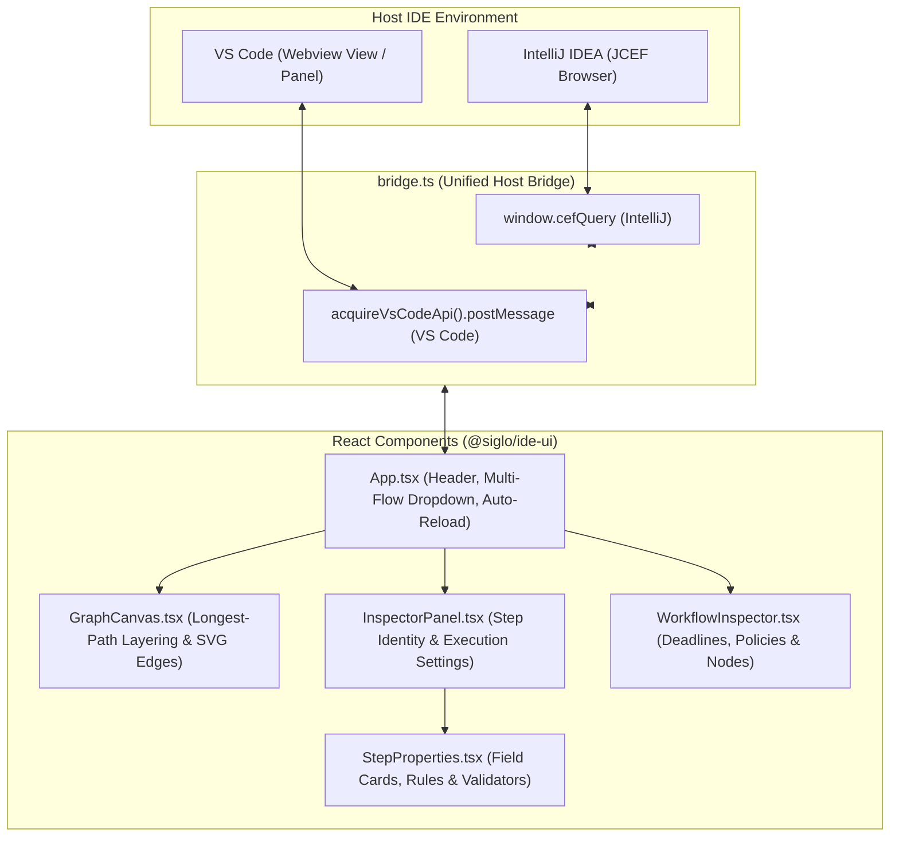

# @siglo/ide-ui

Host-neutral webview micro-bundle providing visual graph rendering and interactive inspectors for Siglo workflows in IntelliJ IDEA and Visual Studio Code.

---

## 1. Overview

`@siglo/ide-ui` is a single-page React application compiled into a standalone, single-file HTML asset (`dist/index.html`) using `vite-plugin-singlefile`. It requires zero external network access, loads instantly in embedded webview environments, and maintains identical aesthetics across IDE light and dark themes.



---

## 2. Key Features

### 1. Longest-Path Layering & Graph Visualization

- Computes deterministic node layering using longest-path algorithms, placing concurrent branches alongside each other and join nodes beneath their inputs.
- Standalone combinators (`parallel`, `allSettled`, `race`, `branch`, `when`, `map`) render explicit `fork` and `join` visual hubs.
- Generates styled SVG cubic bezier curves differentiated by connection type:
    - **Sequential**: Solid slate line with directional arrowhead.
    - **Parallel / Race**: Blue solid line entering fork and exiting join.
    - **Branch / When**: Purple line with condition label (e.g., `SUBPRIME / default`).
    - **Compensation**: Amber dashed line for saga rollback paths.
    - **Fallback**: Rose dashed line for error recovery paths.
- Canvas instances use unique SVG marker IDs (`arrow-${canvasId}`) to prevent cross-canvas marker collisions when rendering multiple workflows in "All Flows" mode.

### 2. Multi-Workflow Explorer

- When a source file declares multiple workflows (e.g. `flow1`, `flow2`, and composite `flow3 = flow(flow1, flow2)`), the header dropdown allows switching between individual flows or viewing "All Flows" simultaneously in separate labeled canvases.
- Long workflow names truncate cleanly with ellipsis in the selector and canvas headers while displaying full titles on hover.

### 3. Structured Step Properties & Input Contracts

- Extracts repeated `.spec(...)` and `.schema(...)` rules on steps and groups them into field cards:
    - Required indicators (`*`), conditional rules, and default values.
    - Validator functions and exception error messages formatted for readability.
    - Transformers and translators with expandable source code snippets.
    - Whole-input schemas rendered under the `$root$` scope.

### 4. Workflow-Level Metadata & Badges

- Workflow deadline (`.timeout(...)`) and schema version (`.version(...)`) appear as visual badges in the canvas header.
- Clicking a workflow label opens `WorkflowInspector.tsx`, detailing execution deadlines, schema version, network perimeter policies (`hosts`, `allowLocalhost`), custom monitoring configurations, and a clickable node catalog.

### 5. Unified Host Bridge (`bridge.ts`)

The webview communicates seamlessly across both major IDE platforms:

- **IntelliJ IDEA**: Communicates via `window.cefQuery` (browser to host) and `window.__SIGLO_BRIDGE__.dispatch` (host to browser).
- **Visual Studio Code**: Communicates via `acquireVsCodeApi().postMessage` (webview to extension) and `window.addEventListener('message')` (extension to webview).
- **Standalone / Mock Mode**: Logs actions to the browser console when run outside an IDE during development.

---

## 3. Directory Layout

```text
packages/ide-ui/
├── src/
│   ├── assets/                # Mascots and brand icons (siglo-logo-128.png)
│   ├── components/
│   │   ├── GraphCanvas.tsx    # Layered node placement, fork/join hubs, SVG connections
│   │   ├── InspectorPanel.tsx # Step identity, retries, timeouts, and coordinates
│   │   ├── StepProperties.tsx # Structured contract cards, field rules, and schemas
│   │   └── WorkflowInspector.tsx # Workflow properties, network perimeter, and node catalog
│   ├── bridge.ts              # Host-neutral messaging bridge (IntelliJ & VS Code)
│   ├── App.tsx                # Master container, header controls, workflow switcher
│   └── main.tsx               # Application mount point
├── dist/
│   └── index.html             # Standalone inlined bundle copied to plugin resources
├── vite.config.ts             # Vite single-file bundler configuration
└── package.json
```

---

## 4. Development & Build

### Running Locally (Browser Mock)

```bash
npm run dev --workspace=@siglo/ide-ui
```

Opens Vite dev server with mock host bridge.

### Typecheck & Production Build

```bash
npx tsc -p packages/ide-ui/tsconfig.json
npm run build --workspace=@siglo/ide-ui
```

Generates `dist/index.html` (approx. 227 kB, inlined CSS and JavaScript).

### Updating IntelliJ Plugin Resources

```bash
cp packages/ide-ui/dist/index.html plugins/intellij/src/main/resources/ide-ui/index.html
```

## Run selected steps

The right-side Run tab supports inclusive sequential selection, JSON input, cancellation, progress, and pretty/raw output. See [execution setup](../ide-runner/README.md).
