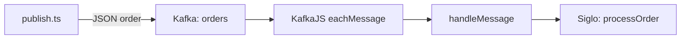
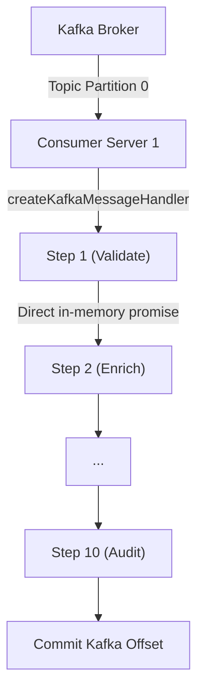
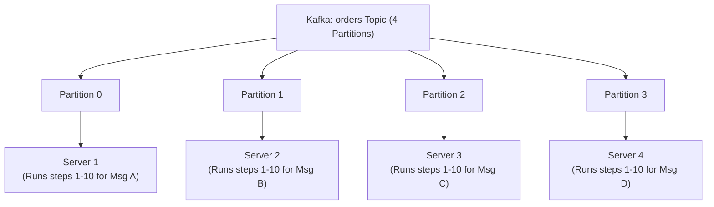
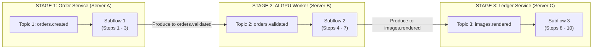

# @siglo/kafka Adapter Guide

`@siglo/kafka` runs Siglo workflows for messages received by a Kafka consumer. Start with a single-step workflow, then add options such as idempotency, timeouts, and tenant routing as needed.

---

## 1. Getting Started

This example publishes a JSON order to Kafka and processes it with one workflow step. You need Node.js (`^22.13.0 || >=24.0.0`) and a running Kafka broker reachable at `localhost:9092`. If your broker uses a different address or requires authentication, update the `Kafka` configuration in both files below.

### Install

In your Node.js project, install the runtime packages and a TypeScript runner:

```bash
npm install @siglo/core @siglo/kafka kafkajs
npm install --save-dev typescript tsx @types/node
```

The KafkaJS peer dependency is `^2.0.0`.

### Create a consumer

Save this as `consumer.ts`:

```typescript
import { Kafka } from 'kafkajs';
import { Step, flow } from '@siglo/core';
import { createKafkaMessageHandler } from '@siglo/kafka';

const processOrder = Step.create('processOrder', async (order: { orderId: string }) => {
    console.log(`Processing order ${order.orderId}`);
    return { processed: true };
});

const handleMessage = createKafkaMessageHandler(flow(processOrder));
const kafka = new Kafka({ clientId: 'orders-consumer', brokers: ['localhost:9092'] });
const consumer = kafka.consumer({ groupId: 'orders-getting-started' });

async function main() {
    await consumer.connect();
    await consumer.subscribe({ topic: 'orders', fromBeginning: true });
    await consumer.run({
        eachMessage: handleMessage,
    });
}

process.on('SIGINT', async () => {
    await consumer.disconnect();
});

main().catch((error) => {
    console.error(error);
    process.exit(1);
});
```

The handler accepts KafkaJS payloads directly. It adds `topic` and `partition` to the message passed to adapter callbacks.

### Publish a test order and run

Save this as `publish.ts`. It creates the demo topic if needed, sends one order, and disconnects:

```typescript
import { Kafka } from 'kafkajs';

const kafka = new Kafka({ clientId: 'orders-producer', brokers: ['localhost:9092'] });

async function main() {
    const admin = kafka.admin();
    await admin.connect();
    try {
        await admin.createTopics({
            topics: [{ topic: 'orders', numPartitions: 1, replicationFactor: 1 }],
        });
    } finally {
        await admin.disconnect();
    }

    const producer = kafka.producer();
    await producer.connect();
    try {
        await producer.send({
            topic: 'orders',
            messages: [{ key: 'order-1', value: JSON.stringify({ orderId: 'order-1' }) }],
        });
    } finally {
        await producer.disconnect();
    }
}

main().catch((error) => {
    console.error(error);
    process.exit(1);
});
```

Run the publisher first so the topic and message exist, then start the consumer:

```bash
npx tsx publish.ts
npx tsx consumer.ts
```

Alongside KafkaJS logs, the consumer prints:

```text
Processing order order-1
```

Leave the consumer running and run `npx tsx publish.ts` in another terminal to send another order. Press **Ctrl+C** to disconnect the consumer. `fromBeginning: true` reads existing records when the consumer group has no committed offset; subsequent runs continue from that group's committed offset.

This example requires no database or idempotency store. Each delivered message runs the workflow from the beginning, and redelivery can repeat processing. For the next steps, see [configuration options](#7-configuration-options-siglokafkaoptions) and the [production consumer example](#9-complete-production-consumer-example).

---

## 2. How It Works

The example follows this path for each order:



1. **The producer writes a record.** `publish.ts` sends a record to the `orders` topic with key `order-1` and a JSON value containing `{ "orderId": "order-1" }`. Kafka stores the record in a partition and assigns it an offset, which identifies its position in that partition.
2. **KafkaJS delivers the record.** The consumer subscribes to `orders` as part of the `orders-getting-started` consumer group. KafkaJS calls `eachMessage` with the record, topic, and partition.
3. **The adapter prepares the workflow input.** `createKafkaMessageHandler(flow(processOrder))` creates a reusable handler. Each call decodes the record's value and parses its JSON, so `processOrder` receives `{ orderId: 'order-1' }`. The Kafka record's key and headers are separate from this input. A custom `input` option can include that metadata when needed.
4. **Siglo runs the workflow.** `flow(processOrder)` contains one step, which logs the order ID and returns `{ processed: true }`. Adding more steps to `flow(...)` runs them in sequence within the same consumer process, with earlier results available to later steps.
5. **The handler finishes.** The adapter returns the workflow result to the caller. In the example, `eachMessage` simply awaits it; returning a result does not publish another Kafka message. With the default auto-commit settings, KafkaJS manages the consumer group's committed offsets after successful processing.

### What happens on failure?

If the workflow throws, the handler rejects and the error propagates to KafkaJS. The failed record is not marked successfully processed by `eachMessage`; retry and restart behavior depends on the KafkaJS consumer configuration. Configure `deadLetter` to quarantine invalid messages or exhausted workflow failures; without it, those errors propagate to KafkaJS. Workflow retries are bounded by `retry.maxAttempts` per delivery. When KafkaJS supplies a `heartbeat` callback, the adapter calls it before and periodically during record processing (every 5 seconds by default). A heartbeat failure requests workflow cancellation through its abort signal and rejects processing. Heartbeats require a responsive event loop; synchronous CPU work can still block them.

A crash before an offset is committed can cause a record to be delivered again. Each delivery starts the workflow from the beginning, so external actions such as charging a payment should use an idempotency key to avoid repeating the action.

### What do the optional settings add?

The basic handler works without options. An `idempotencyStore` with `groupId` tracks claims and completed results within the consumer group and tenant, `validate` checks input, and `timeout` sets a processing deadline. Malformed JSON is rejected by default, while null-valued tombstones are skipped. See [production policies](#11-production-policies) for retry, dead-letter, and shutdown examples. The adapter can also read the namespace from the record's `x-namespace` header. See the [configuration options](#7-configuration-options-siglokafkaoptions) for details.

> **Note on guarantees:** An idempotency claim does not make external effects atomic with workflow completion. If a payment succeeds and the process crashes before the claim is completed, a later retry may repeat the payment after the claim expires. Use provider-level deduplication keys for those effects.

---

## 3. Execution Model: In-Process vs. Distributed Step Execution

A common question in distributed event-driven systems is:

> **"If I have a 10-step workflow, will those 10 steps run across different consumer servers?"**

### Direct Answer: **No. By default, all 10 steps execute in-process on the single consumer server that pulled the Kafka message.**

`Siglo` is an **in-process orchestrator** rather than a multi-machine RPC scheduler (such as Temporal or AWS Step Functions).

When an instance of your consumer service pulls a Kafka record, the entire 10-step pipeline runs in-memory on that node:



### In-Process Execution Architectural Trade-offs

| Dimension | In-Process Orchestration (`Siglo`) | Distributed Step Orchestration |
| :--- | :--- | :--- |
| **Step-to-Step Invocation** | Direct in-memory async promise chaining. | Every step requires network RPC, queue write, and external coordination. |
| **Execution Boundary** | Runs full workflow in-process on consumer node. | Dispatches individual steps across cluster workers. |
| **Payload Handling** | Pass rich domain models, Buffers, Maps, or Streams directly in memory. | Payloads must be serialized to JSON across each step boundary. |
| **Infrastructure Overhead** | Runs directly inside your application container with no extra engine servers. | Requires external orchestrator clusters and database infrastructure. |
| **Debugging & Local Testing** | Standard debugger breakpoints stepping directly between steps. | Requires cross-machine distributed trace correlation and event replay. |
| **Saga Compensation** | Immediate in-process reverse rollback if downstream step fails. | Rollback messages queue behind other cluster tasks. |

#### 1. In-Process vs. Multi-Hop Step Orchestration
In systems that distribute every individual step to different servers across a network, each step boundary incurs serialization, broker scheduling, and network transfer overhead. In `Siglo`, Step 1 yields to Step 2 directly in memory with zero network latency.

#### 2. Horizontally Scaling via Partitions
Work is scaled horizontally by **Kafka Partitions (Message-Level Distribution)**, not by splitting individual steps across machines:



Each consumer server processes independent messages in parallel at full hardware capability with maximum CPU cache locality.

---

## 4. How to Distribute Steps Across Different Servers (When Needed)

Distributing individual steps across physically separate machines is only necessary in specific architectural scenarios:
1. **Heterogeneous Compute**: Steps 1–3 run on standard Node.js CPU instances, but Step 4 requires dedicated GPU worker nodes (e.g. AI model inference).
2. **Distinct Microservice Boundaries**: Steps 1–3 belong to the *Checkout Team*, while Steps 4–7 belong to the *Fulfillment Team*.
3. **Multi-Hour Uninterruptible Tasks**: Tasks taking hours where a crash cannot afford restarting from Step 1.

For these cases, implement **Event-Driven Choreography** using intermediate Kafka topics:



### Pattern Example: Chaining Workflows Across Topics

```typescript
// --- SERVICE A: Order Service (Runs Steps 1 to 3) ---
const step1 = Step.create('validate', async (order: any) => ({ valid: true, order }));
const step2 = Step.create('checkCredit', async (ctx: any) => ({ creditApproved: true }));
const step3_publish = Step.create('publishValidated', async (ctx: any) => {
    // Produce message to intermediate topic for Service B
    await kafkaProducer.send({
        topic: 'orders.validated',
        messages: [{ key: ctx.order.id, value: JSON.stringify(ctx) }],
    });
    return { published: true };
});

const stage1Flow = flow(step1, step2, step3_publish);
const stage1Handler = createKafkaMessageHandler(stage1Flow);


// --- SERVICE B: GPU Processing Service (Runs Steps 4 to 6) ---
const step4 = Step.create('generateAssets', async (ctx: any) => ({ assetUrl: 'https://...' }));
const step5 = Step.create('renderVideo', async (ctx: any) => ({ videoRendered: true }));
const step6_publish = Step.create('publishRendered', async (ctx: any) => {
    await kafkaProducer.send({
        topic: 'images.rendered',
        messages: [{ key: ctx.order.id, value: JSON.stringify(ctx) }],
    });
    return { dispatched: true };
});

const stage2Flow = flow(step4, step5, step6_publish);
const stage2Handler = createKafkaMessageHandler(stage2Flow);
```

---

## 5. Crash Recovery, Rebalances & Failure Semantics

What happens if Server 1 is executing **Step 6** of 10 and the process crashes?

1. **Uncommitted Offset**: The handler rejects when a workflow fails. With the default KafkaJS processing settings, that record remains unresolved; earlier successful records may already have committed offsets.
2. **Kafka Partition Rebalance**: Kafka detects consumer heartbeat loss and reassigns that topic partition to another consumer (Server 2).
3. **Idempotency Protection**: Server 2 re-receives records from the last committed offset. A configured `IdempotencyStore` skips completed records and rejects records with active claims. An expired claim permits replay, so external effects still need their own deduplication keys.
4. **Workflow Restart**: This adapter starts each workflow from the beginning. It does not automatically restore durable checkpoints.

---

## 6. API Reference

### `createKafkaMessageHandler(workflow, options)`

Creates a handler for `consumer.run({ eachMessage: handler })`:

```typescript
function createKafkaMessageHandler<TInput = any, TOutput = any>(
    workflow: Flow<TInput, TOutput>,
    options?: SigloKafkaOptions<TInput, TOutput>
): (payload: SigloKafkaPayload) => Promise<any>;

interface SigloKafkaPayload {
    topic: string;
    partition: number;
    message: SigloKafkaRecord; // Kafka record; nested topic/partition are optional
    heartbeat?: () => Promise<void>;
    isRunning?: () => boolean;
    isStale?: () => boolean;
}
```

### `SigloKafkaMessage` Interface

```typescript
export interface SigloKafkaMessage {
    key?: Buffer | string | null;
    value?: Buffer | string | null;
    partition: number;
    topic: string;
    offset: string;
    timestamp?: string;
    headers?: Record<string, Buffer | string | (Buffer | string)[] | undefined>;
}
```

---

## 7. Configuration Options (`SigloKafkaOptions`)

| Option | Type | Default | Description |
| :--- | :--- | :--- | :--- |
| `input` | `(message) => TInput \| Promise<TInput>` | JSON parser | Custom deserializer with record metadata. |
| `validate` | `(input, message) => void \| Promise<void>` | `undefined` | Throw to reject invalid workflow input before execution. |
| `invalidJson` | `'error' \| 'raw'` | `'error'` | Reject malformed JSON, or pass `{ raw: string }` for legacy behavior. |
| `tombstone` | `'skip' \| 'error' \| 'process'` | `'skip'` | Skip null values, reject them, or run the input mapper/workflow. |
| `output` | `(result, message) => TOutput \| Promise<TOutput>` | Workflow result | Formats successful workflow results, including cached ones. Not called for skips or dead letters. |
| `groupId` | `string` | `undefined` | Required with an idempotency store. Set to the KafkaJS consumer group ID. |
| `idempotencyStore` | `IdempotencyStore` | `undefined` | Tracks claims and results. Use a shared store across replicas of one consumer group. |
| `idempotencyKey` | `(message) => string` | `getKafkaRecordId(message)` | Business identity; automatically scoped by group and tenant. |
| `idempotencyTtlMs` | `number` | `86400000` | TTL passed explicitly to the store. Processing stops at 80% of this budget; claims are not renewed. |
| `heartbeatIntervalMs` | `number` | `5000` | Kafka heartbeat cadence; set below the session timeout. `0` disables heartbeats, while cancellation checks remain active. |
| `timeout` | `number` | `undefined` | Record processing budget in milliseconds, including retries. With a store, must be less than 80% of its TTL. |
| `namespace` | `string \| (message) => string \| undefined` | `x-namespace` header | Tenant scope, also included in idempotency keys. |
| `signal` | `AbortSignal` | `undefined` | Application shutdown/cancellation signal, forwarded to the workflow. |
| `retry` | `{ maxAttempts, delayMs?, shouldRetry? }` | One attempt | Retries workflow errors only; `maxAttempts` includes the initial run. |
| `deadLetter` | `(failure: KafkaDeadLetter) => Promise<void>` | `undefined` | Awaited quarantine callback after invalid input or exhausted workflow attempts. |

---

## 8. Idempotency Key Semantics

`getKafkaRecordId(message)` returns `kafka:<topic>:<partition>:<offset>`. This distinguishes events that share an entity key and stays stable across record redelivery. It is also useful for deduplication at external providers when a business event ID is unavailable.

Stored claim keys use `kafka:` followed by a JSON array of `[groupId, namespaceOrNull, identity]`. The default identity is the record ID. JSON encoding keeps group and tenant boundaries unambiguous. Independent consumer groups can safely share a store when each supplies its own `groupId`.

For business deduplication across records, provide a stable event ID through a header:

```typescript
const handler = createKafkaMessageHandler(orderWorkflow, {
    groupId: 'orders-service',
    idempotencyStore,
    idempotencyKey: message => {
        const eventId = message.headers?.['event-id'];
        return eventId === undefined ? getKafkaRecordId(message) : String(eventId);
    },
});
```

Import `getKafkaRecordId` from `@siglo/kafka`. A Kafka key commonly identifies an entity shared by multiple events; only use it as a business deduplication key when it uniquely identifies an event.

### Claim states

1. `'completed'`: Reads the cached outcome through `store.get()` without rerunning the workflow. Successful results still pass through `output`; cached skips and dead letters do not. Stores without cached-result access return `{ deduplicated: true }`.
2. `'in-progress'`: Rejects processing so an active claim is not treated as successfully handled.
3. `'claimed'`: Executes the workflow and saves its result or handled disposition. An ordinary processing failure releases the claim so a retry is possible.

Cancellation, heartbeat loss, timeouts, and uncertain completion writes retain claims until expiry. Output-mapping errors retain completed claims. This prevents immediate replay while external work may still be running. The default claim TTL is 24 hours; choose a shorter explicit TTL when faster recovery is needed, while keeping it comfortably above the total processing budget.

**Migration:** Deduplication now requires `groupId`, and keys include the group and tenant. Previous stored keys do not match this format, even when `idempotencyKey` uses the earlier identity algorithm. Plan the deployment with idempotent external effects and avoid overlapping old and new consumers with different claim formats. Cached outcomes now use a reserved `$sigloKafka` envelope internally; adapter callers receive the result or disposition, not the envelope.

Malformed JSON now rejects by default and tombstones are skipped. Set `invalidJson: 'raw'` and `tombstone: 'process'` to retain the earlier parsing behavior.

---

## 9. Complete Production Consumer Example

```typescript
import { Kafka } from 'kafkajs';
import { Step, flow } from '@siglo/core';
import { createKafkaMessageHandler } from '@siglo/kafka';
import { PostgresIdempotencyStore } from '@siglo/postgres';
import { Pool } from 'pg';

// 1. Database & Idempotency Store
const pgPool = new Pool({ connectionString: process.env.DATABASE_URL });
const idempotencyStore = new PostgresIdempotencyStore({ client: pgPool });
await idempotencyStore.ensureTable();

// 2. Define Transaction Processing Workflow
interface PaymentEvent {
    paymentId: string;
    accountId: string;
    amount: number;
    currency: string;
}

const validateAccount = Step.create('validateAccount', async (param: PaymentEvent) => {
    console.log(`Checking account ${param.accountId} balance for payment ${param.paymentId}`);
    return { accountValid: true };
});

const debitAccount = Step.create('debitAccount', async (param: any) => {
    console.log(`Debiting ${param.amount} ${param.currency} from ${param.accountId}`);
    return { ledgerEntryId: `led_${Date.now()}`, debited: true };
});

const paymentPipeline = flow(validateAccount, debitAccount);

// 3. Setup Kafka Consumer
const kafka = new Kafka({
    clientId: 'payment-consumer-service',
    brokers: ['localhost:9092'],
});

const consumer = kafka.consumer({ groupId: 'payment-engine-group' });

const messageHandler = createKafkaMessageHandler(paymentPipeline, {
    groupId: 'payment-engine-group',
    idempotencyStore,
    idempotencyTtlMs: 3600000, // 1 hour claim lock
    timeout: 5000,             // 5s execution SLA
    namespace: (msg) => String(msg.headers?.['x-tenant-id'] || 'default'),
});

await consumer.connect();
await consumer.subscribe({ topic: 'payments.inbound', fromBeginning: false });

await consumer.run({
    eachMessage: async (payload) => {
        try {
            const result = await messageHandler(payload);
            console.log(`Processed payment message offset ${payload.message.offset}:`, result);
        } catch (err: any) {
            console.error(`Failed processing message at offset ${payload.message.offset}: ${err.message}`);
            // Depending on architecture: push to Dead Letter Queue (DLQ) or let consumer retry
            throw err;
        }
    },
});

// 4. Graceful Shutdown
process.on('SIGTERM', async () => {
    console.log('Disconnecting Kafka consumer...');
    await consumer.disconnect();
    await pgPool.end();
    process.exit(0);
});
```


---

## 10. Batch Processing

Use `createKafkaBatchHandler` when you want explicit control over progress within each partition batch. After connecting and subscribing a KafkaJS consumer:

```typescript
import { createKafkaBatchHandler } from '@siglo/kafka';

await consumer.run({
    eachBatchAutoResolve: false,
    eachBatch: createKafkaBatchHandler(orderWorkflow, {
        groupId: 'orders-service',
        idempotencyStore,
        heartbeatIntervalMs: 3000,
    }),
});
```

Records run sequentially within each batch. After each successful handler call, the adapter checks that the consumer is running and the batch is still current, heartbeats, resolves that record's offset, and calls KafkaJS's `commitOffsetsIfNecessary()`. The callback checks KafkaJS's configured commit interval and threshold. It can commit when those conditions are met even if consumer auto-commit is disabled. For fully manual commits, set both KafkaJS's `autoCommit: false` and the adapter's batch option `commitOffsets: false`; records will still be resolved locally.

An error stops the batch and leaves the failed and subsequent records unresolved. Stopping the consumer or marking a batch stale also stops further processing and offset resolution; the adapter requests cancellation of an active workflow. External operations must honor the workflow abort signal to stop their work. Keep `eachBatchAutoResolve: false` so KafkaJS does not automatically resolve the rest of a partially processed batch.


---

## 11. Production Policies

After defining `orderWorkflow`, an idempotency store, and a connected KafkaJS producer, configure validation, retries, and quarantine:

```typescript
const shutdown = new AbortController();
const handler = createKafkaMessageHandler(orderWorkflow, {
    groupId: 'orders-service', // Match the KafkaJS consumer group.
    idempotencyStore,
    idempotencyTtlMs: 60000,
    timeout: 30000,
    signal: shutdown.signal,
    validate: order => {
        if (!order || typeof order.orderId !== 'string') {
            throw new Error('orderId is required');
        }
    },
    retry: {
        maxAttempts: 3,
        delayMs: 500,
        shouldRetry: error => !(error instanceof PermanentOrderError),
    },
    deadLetter: async ({ message, recordId, error, attempts }) => {
        const value = message.value == null ? null : Buffer.isBuffer(message.value)
            ? message.value.toString('base64')
            : Buffer.from(message.value).toString('base64');
        await producer.send({
            topic: 'orders.dead-letter',
            messages: [{
                key: recordId,
                value: JSON.stringify({
                    recordId, sourceTopic: message.topic, partition: message.partition,
                    offset: message.offset, valueBase64: value,
                    error: String(error), attempts,
                }),
            }],
        });
    },
});
```

`PermanentOrderError` represents an application-defined error class. Create the dead-letter topic before consuming and make the callback reject if publication fails. Invalid JSON, rejected tombstones, and validation errors go directly to the callback with zero workflow attempts. Transient workflow errors retry up to the configured limit, restarting the whole workflow each time. The limit applies per delivery; without successful quarantine, later redeliveries may retry again.

The adapter waits for dead-letter publication before acknowledging a handled failure. When a store is configured, it caches the disposition to avoid publishing again on ordinary redelivery. A crash between publication and recording that disposition can still publish a duplicate; the destination should deduplicate with `recordId`. Cancellation, heartbeat failures, store failures, and output-mapping errors do not go to the dead-letter callback.

For graceful shutdown, abort processing before disconnecting. For example, after creating `consumer` and `producer`:

```typescript
process.once('SIGTERM', async () => {
    shutdown.abort();
    await consumer.disconnect();
    await producer.disconnect();
});
```

The signal is forwarded to Siglo steps. Pass the step's abort signal to external clients that support cancellation. Batch processing also checks for stopped consumers and stale batches during execution, even when automatic heartbeats are disabled. A cancelled record remains unresolved.

### Long workflows and external effects

With a store configured, the adapter stops processing at 80% of `idempotencyTtlMs` or at the earlier `timeout`. This leaves a margin before claim expiry; it does not renew claims or provide ownership fencing at the storage layer. Timers require a responsive event loop. Checks after callbacks also reject late results instead of completing the claim after the deadline.

Cancellation prevents further adapter work, but cannot undo a payment or forcibly stop an external operation that ignores its signal. Use a stable business event ID as the provider's idempotency key. An expired claim, a long process pause, or a delayed store write can still race with another consumer; the generic store API cannot eliminate those races. Split work that exceeds the claim budget into separately persisted stages rather than relying on an arbitrarily long claim.

For a database update followed by a Kafka event, use the [transactional inbox and outbox example](docs/outbox.md). It commits the database effect, processed-event marker, and pending outgoing event together, then relays the event with a stable ID.

---

## 12. Live Kafka Recovery Tests

From the repository root, with Docker available:

```bash
docker compose -p siglo-kafka-recovery-tests -f packages/kafka/integration/compose.yaml up -d --wait
npm run test:integration --workspace=@siglo/kafka
docker compose -p siglo-kafka-recovery-tests -f packages/kafka/integration/compose.yaml down -v
```

The isolated broker listens on `localhost:19092`, and PostgreSQL for the outbox recipe listens on `localhost:15434`. Set `KAFKA_BROKER` and `OUTBOX_DATABASE_URL` to use other test services. Tests create uniquely named topics and delete them afterward. They exercise shared keys across independent groups, poison-message quarantine, tombstones, offset recovery after a process is killed, provider-level effect deduplication, and rebalances during long workflows. The PostgreSQL test executes the published outbox recipe, checking concurrent duplicate events, transaction rollback, and stable outgoing event IDs after an uncertain send. Unit tests cover cancellation, lease deadlines, validation, retry exhaustion, and failed dead-letter publication.
