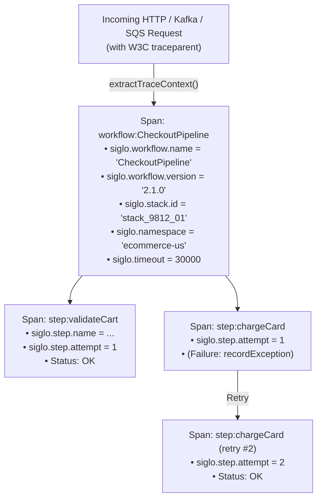

# @siglo/opentelemetry Adapter Guide

`@siglo/opentelemetry` provides vendor-neutral distributed tracing, semantic spans, context event streaming, and W3C Trace Context propagation for `Siglo` workflows. It is fully compliant with the OpenTelemetry API (`@opentelemetry/api` v1.9.0+) and integrates seamlessly with collectors like Jaeger, Zipkin, Datadog, Prometheus, New Relic, and AWS X-Ray.

---

## 1. Overview & Architecture

The OpenTelemetry integration creates an end-to-end distributed span hierarchy covering workflows, steps, retries, and context mutations:



---

## 2. Installation & Requirements

Install `@siglo/opentelemetry` and the OpenTelemetry API:

```bash
npm install @siglo/core @siglo/opentelemetry @opentelemetry/api
```

Recommended OpenTelemetry SDK packages for Node.js:
```bash
npm install --save-dev @opentelemetry/sdk-node @opentelemetry/sdk-trace-node @opentelemetry/exporter-trace-otlp-grpc
```

---

## 3. Semantic Attributes Reference

`SemanticAttributes` defines standardized OpenTelemetry attribute keys:

| Attribute Constant | String Key | Type | Description |
| :--- | :--- | :--- | :--- |
| `WORKFLOW_NAME` | `siglo.workflow.name` | `string` | Canonical name of the executing workflow. |
| `WORKFLOW_VERSION` | `siglo.workflow.version` | `string` | Semantic version string of the workflow. |
| `WORKFLOW_ID` | `siglo.workflow.id` | `string` | Unique workflow identifier. |
| `STACK_ID` | `siglo.stack.id` | `string` | Unique stack execution identifier. |
| `STEP_NAME` | `siglo.step.name` | `string` | Name or debug label of the active step. |
| `STEP_ID` | `siglo.step.id` | `string` | Internal node identifier in the workflow graph AST. |
| `STEP_ATTEMPT` | `siglo.step.attempt` | `number` | 1-based attempt count (incremented on retries). |
| `NAMESPACE` | `siglo.namespace` | `string` | Tenant namespace partition (requires `allowNamespace: true`). |
| `CACHE_HIT` | `siglo.cache.hit` | `boolean` | `true` if step result was served from cache. |
| `TIMEOUT` | `siglo.timeout` | `number` | Configured timeout in milliseconds. |

---

## 4. API Reference

### `instrumentWorkflow(workflow, options)`

Instruments a `Flow` instance with a root span, sets execution attributes, and automatically instruments all child steps:

```typescript
function instrumentWorkflow<TInput = any, TOutput = any>(
    workflow: Flow<TInput, TOutput>,
    options?: SigloTelemetryOptions
): Flow<TInput, TOutput>;
```

#### Options (`SigloTelemetryOptions`):
- `tracer` (`Tracer`): Custom OpenTelemetry `Tracer` instance. If omitted, uses `trace.getTracer('@siglo/opentelemetry', '1.0.4')`.
- `serviceName` (`string`): Tracer service name identifier.
- `workflowName` (`string`): Override workflow span label.
- `workflowVersion` (`string`): Workflow version (default: `'1.0.0'`).
- `allowNamespace` (`boolean`): If `true`, injects `siglo.namespace` into span attributes. Default `false` to prevent accidental namespace leakage.
- `allowContextFields` (`string[]`): Whitelist of step context mutation keys that are allowed to be recorded as span attributes.
- `redactHook` (`(key: string, value: unknown) => unknown`): Sanitizer hook to scrub sensitive or PII data before recording attributes.

---

### `instrumentStep(step, options)`

Wraps an individual `Step` with a child span covering step execution, attempt count tracking, status reporting, and exception capturing:

```typescript
function instrumentStep<TInput = any, TOutput = any>(
    step: Step<TInput, TOutput>,
    options?: SigloTelemetryOptions
): Step<TInput, TOutput>;
```

---

### `createTelemetryStorageAdapter(options)`

Creates a `StorageAdapter` that transforms context changes into OpenTelemetry span attributes:

```typescript
function createTelemetryStorageAdapter(options?: SigloTelemetryOptions): StorageAdapter;
```

#### Security & PII Protection:
By default, **no context fields are streamed to OpenTelemetry spans**. Only fields explicitly declared in `allowContextFields` are emitted as `siglo.context.<field>`, and all values pass through `redactHook` if configured.

---

### W3C Distributed Context Propagation Helpers

- **`injectTraceContext(carrier, ctx?)`**: Injects active OpenTelemetry span context into headers or metadata dictionaries.
- **`extractTraceContext(carrier, ctx?)`**: Extracts OpenTelemetry `Context` from HTTP headers or Kafka message headers.
- **`getTraceHeaders(span?)`**: Returns `{ traceparent: string, tracestate?: string }` from the active or supplied span.

---

## 5. Complete Production Instrumentation Example

```typescript
import { NodeSDK } from '@opentelemetry/sdk-node';
import { OTLPTraceExporter } from '@opentelemetry/exporter-trace-otlp-grpc';
import { trace } from '@opentelemetry/api';
import { Step, flow } from '@siglo/core';
import {
    instrumentWorkflow,
    createTelemetryStorageAdapter,
    getTraceHeaders
} from '@siglo/opentelemetry';

// 1. Initialize OpenTelemetry SDK
const sdk = new NodeSDK({
    traceExporter: new OTLPTraceExporter({ url: 'http://localhost:4317' }),
    serviceName: 'order-service',
});
sdk.start();

const tracer = trace.getTracer('order-service', '1.0.0');

// 2. Configure Storage Adapter with PII Sanitization
const telemetryStorage = createTelemetryStorageAdapter({
    allowContextFields: ['orderId', 'orderStatus', 'cardLast4', 'totalAmount'],
    redactHook: (key, val) => {
        if (key === 'cardLast4') {
            return `****${String(val).slice(-4)}`;
        }
        return val;
    },
});
Step.useStorage(telemetryStorage);

// 3. Define Workflow Steps with Retry
const validateOrder = Step.create('validateOrder', async (input: any) => {
    return { orderId: input.orderId, validated: true };
});

const chargePayment = Step.create('chargePayment', async (param: any) => {
    // Simulate transient failure on first attempt
    if (param.$attempt && param.$attempt() === 0) {
        throw new Error('Temporary payment gateway blip');
    }
    return { paymentStatus: 'CHARGED', cardLast4: '4242' };
})
    .onFail({ maxRetries: 2, delay: 100 });

const orderWorkflow = flow(validateOrder, chargePayment);

// 4. Instrument Workflow
const monitoredWorkflow = instrumentWorkflow(orderWorkflow, {
    tracer,
    workflowName: 'CustomerOrderProcessing',
    workflowVersion: '2.4.0',
    allowNamespace: true,
});

// 5. Run Monitored Workflow
const result = await monitoredWorkflow.run(
    { orderId: 'ORD-7718', totalAmount: 89.5 },
    { namespace: 'tenant-emea' }
);

console.log('Workflow finished with Stack ID:', result.$stackId());
console.log('Outgoing W3C Headers for downstreams:', getTraceHeaders());
```
