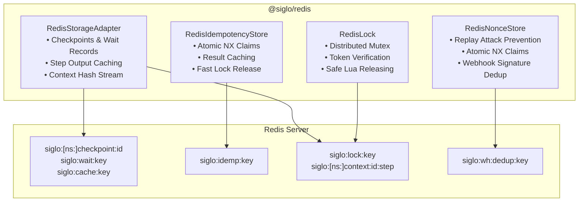

# @siglo/redis Adapter Guide

`@siglo/redis` provides an in-memory distributed persistence, step response caching, atomic idempotency deduplication, distributed single-flight coordination, and webhook replay prevention layer for `Siglo` workflows. It is powered by Redis and compatible with standalone Redis, Redis Sentinel, and Redis Cluster via `ioredis` (or any client implementing `RedisClientInterface`).

---

## 1. Overview & Architecture

The Redis adapter family encompasses four core modules:

1. **`RedisStorageAdapter`**: Implements the Siglo `StorageAdapter` interface for execution stack checkpointing (with tenant isolation), durable wait record indexing for event-driven suspensions, step response caching, and non-blocking context mutation streaming.
2. **`RedisIdempotencyStore`**: Implements the Siglo `IdempotencyStore` interface for atomic, distributed single-flight execution claims, cached result retrieval, and automated lock releasing on failure.
3. **`RedisLock`**: Distributed mutex coordinator with unique per-worker token verification, single-flight helper execution (`withLock`), and optional strict Lua atomicity (`strictAtomicity`) to eliminate TOCTOU release races.
4. **`RedisNonceStore`**: Distributed atomic deduplication store for webhook signatures and replay attack prevention, enforcing single-use delivery within tolerance windows.



---

## 2. Installation & Requirements

Install `@siglo/redis` alongside `@siglo/core` and `ioredis`:

```bash
npm install @siglo/core @siglo/redis ioredis
```

### Peer Dependency Matrix

| Package       | Version              | Requirement                                                                                   |
| :------------ | :------------------- | :-------------------------------------------------------------------------------------------- |
| `@siglo/core` | `^1.0.0`             | Core workflow engine & interfaces (`StorageAdapter`, `IdempotencyStore`)                      |
| `ioredis`     | `^5.0.0 \|\| ^6.0.0` | Optional peer dependency (any client matching `RedisClientInterface`)                         |
| Redis Server  | `6.0+`               | Requires `SET ... PX ... NX`, hashes (`HSET`, `HGETALL`), and optional Lua scripting (`EVAL`) |

---

## 3. Key Topology & Redis Data Structures

`@siglo/redis` uses structured key namespaces across all components:

| Key Pattern                               | Redis Type       | Default TTL                              | Description                                                                                                                          |
| :---------------------------------------- | :--------------- | :--------------------------------------- | :----------------------------------------------------------------------------------------------------------------------------------- |
| `siglo:[<ns>:]checkpoint:<stackId>`       | `string` (JSON)  | 7 days (`604800000ms`)                   | Serialized execution stack for workflow resumption. Partitioned by tenant namespace if provided (`siglo:<ns>:checkpoint:<stackId>`). |
| `siglo:cache:<key>`                       | `string` (JSON)  | 24 hours (`86400000ms`)                  | Cached step evaluation output. Can be overridden per `setCachedStep` call.                                                           |
| `siglo:wait:<key>`                        | `string` (JSON)  | 7 days (`604800000ms`)                   | Durable wait/continuation record. Indexed by `correlationKey` and/or `stackId`.                                                      |
| `siglo:[<ns>:]context:<stackId>:<stepId>` | `hash`           | 7 days (`604800000ms`)                   | Active context field mutations for auditing. Partitioned by tenant namespace if provided. TTL refreshed via `PEXPIRE`.               |
| `siglo:idemp:<key>`                       | `string`         | 24 hours (`86400000ms`)                  | Idempotency lock status (`in-progress` or `COMPLETED:<json>`). Can be overridden per claim/complete.                                 |
| `siglo:lock:<key>`                        | `string`         | 10 seconds (`10000ms`)                   | Distributed mutex lock holding worker token (`lock_<timestamp>_<randomHex>` or custom).                                              |
| `siglo:wh:dedup:<key>`                    | `string` (`"1"`) | Caller specified (`ttlSeconds * 1000ms`) | Nonce deduplication token for webhook replay attack prevention.                                                                      |

---

## 4. `RedisClientInterface` & Driver Compatibility

`@siglo/redis` communicates through `RedisClientInterface`, decoupling the adapter from a specific driver version and simplifying mock testing:

```typescript
export interface RedisClientInterface {
    get(key: string): Promise<string | null>;
    set(key: string, value: string, ...args: any[]): Promise<'OK' | string | null>;
    del(key: string | string[]): Promise<number>;
    hset(key: string, field: string | Record<string, string>, value?: string): Promise<number>;
    hgetall?(key: string): Promise<Record<string, string>>;
    expire?(key: string, seconds: number): Promise<number>;
    pexpire?(key: string, milliseconds: number): Promise<number>;
    eval?(script: string, numKeys: number, ...args: (string | number)[]): Promise<any>;
}
```

Standard `ioredis` instances (`Redis`, `Cluster`, `Sentinel`) fulfill this interface out-of-the-box without requiring wrappers.

---

## 5. `RedisStorageAdapter` Reference

Implements the Siglo `StorageAdapter` interface (`name = 'redis'`) for high-performance checkpointing, step output caching, wait record indexing, and context mutation streaming.

```typescript
import { RedisStorageAdapter } from '@siglo/redis';
```

### Options (`RedisStorageAdapterOptions`)

| Option                 | Type                   | Default               | Description                                                        |
| :--------------------- | :--------------------- | :-------------------- | :----------------------------------------------------------------- |
| `client`               | `RedisClientInterface` | _Required_            | Active Redis client instance (e.g., `ioredis`). Throws if omitted. |
| `keyPrefix`            | `string`               | `'siglo:'`            | Root prefix for all Redis keys created by this adapter.            |
| `checkpointTtlMs`      | `number`               | `604800000` (7 days)  | TTL for checkpoints, wait records, and context hashes.             |
| `cacheTtlMs`           | `number`               | `86400000` (24 hours) | Default step response cache expiration TTL.                        |
| `recordContextChanges` | `boolean`              | `true`                | When `true`, streams field updates to Redis hashes.                |

### Methods

- **`saveCheckpoint(checkpoint: SerializedExecutionStack): Promise<void>`**:
  Saves the JSON-serialized execution stack with millisecond TTL (`SET key val PX checkpointTtlMs`). If `checkpoint.namespace` is provided, stores under `siglo:<ns>:checkpoint:<stackId>`. Returns early if `checkpoint` or `checkpoint.stackId` is missing.
- **`getCheckpoint(stackId: string, namespace?: string): Promise<SerializedExecutionStack | undefined>`**:
  Retrieves and parses the serialized checkpoint. If `namespace` is specified, checks the tenant-namespaced key first, falling back to the un-namespaced key if not found. Returns `undefined` if missing or if parsing fails.
- **`saveWaitRecord(record: any): Promise<void>`**:
  Persists durable wait/continuation records for event-driven workflows (e.g., `waitForEvent`). Dual-indexes the record under `siglo:wait:<correlationKey>` (if present) and `siglo:wait:<stackId>` (if present) with `checkpointTtlMs`.
- **`getWaitRecord(correlationKeyOrStackId: string): Promise<any | undefined>`**:
  Retrieves a wait record by correlation key or stack ID from `siglo:wait:<key>`. If not found, falls back to inspecting `cp?.metadata?.waitRecord` from `getCheckpoint(correlationKeyOrStackId)`.
- **`cleanExpiredCheckpoints(): Promise<number>`**:
  Returns `0`. TTL expiration is handled automatically by Redis native keyspace expiration, eliminating background cleanup sweeps.
- **`getCachedStep(key: string): Promise<any | undefined>`**:
  Retrieves cached step response from `siglo:cache:<key>`. Returns parsed JSON, or the raw string if not JSON, or `undefined` if key does not exist.
- **`setCachedStep(key: string, value: any, ttlMs?: number): Promise<void>`**:
  Writes cached step evaluation to `siglo:cache:<key>` with `PX` TTL (`ttlMs || cacheTtlMs`). Objects are serialized directly; primitives are wrapped as `{ value }`.
- **`onContextChange(entry): Promise<void>`**:
  When `recordContextChanges` is `true`, writes field mutations to `HSET` at `siglo:[<ns>:]context:<stackId>:<stepId>` and refreshes expiration with `PEXPIRE` (`checkpointTtlMs`). Errors are silently caught to ensure non-blocking telemetry.

---

## 6. `RedisIdempotencyStore` Reference

Provides distributed, atomic idempotency guarantees across multi-instance clusters using Redis `SET key val PX ttl NX` semantics. Implements the Siglo `IdempotencyStore` interface.

```typescript
import { RedisIdempotencyStore } from '@siglo/redis';
```

### Options (`RedisIdempotencyOptions`)

| Option         | Type                   | Default               | Description                                      |
| :------------- | :--------------------- | :-------------------- | :----------------------------------------------- |
| `client`       | `RedisClientInterface` | _Required_            | Active Redis client instance. Throws if omitted. |
| `keyPrefix`    | `string`               | `'siglo:idemp:'`      | Root prefix for idempotency keys.                |
| `defaultTtlMs` | `number`               | `86400000` (24 hours) | Default lock expiration TTL.                     |

### Claim States & Lifecycle Transitions

1. **`claim(key: string, ttlMs?: number): Promise<'claimed' | 'completed' | 'in-progress'>`**:
    - Executes atomic Redis `SET <keyPrefix><key> "in-progress" PX <effectiveTtl> NX`.
    - If Redis returns `'OK'`: Returns `'claimed'` (caller acquired exclusive execution right).
    - If the key already exists and starts with `COMPLETED:`: Returns `'completed'`.
    - Otherwise returns `'in-progress'` (another worker is currently processing this key).
2. **`complete(key: string, result: unknown, ttlMs?: number): Promise<void>`**:
    - Overwrites key with `COMPLETED:${JSON.stringify(result ?? null)}` and resets TTL to `effectiveTtl`.
3. **`fail(key: string, _error: unknown): Promise<void>`**:
    - Reads the key and deletes it (`DEL`) **only** if its current value is `'in-progress'`. This frees the lock for immediate retry execution while preserving already completed results.
4. **`getResult(key: string): Promise<unknown | undefined>`**:
    - Reads the key. If it starts with `COMPLETED:`, deserializes and returns the JSON payload. Returns `undefined` if missing or if parsing fails.
5. **`get(key: string): Promise<unknown | undefined>`**:
    - Direct alias delegating to `getResult(key)`.

---

## 7. `RedisLock` (Distributed Mutex & Single-Flight Coordination)

`RedisLock` prevents duplicate parallel execution of sensitive workflows (e.g., end-of-month payroll, nightly data synchronization) across multiple server instances.

```typescript
import { RedisLock, RedisLockOptions } from '@siglo/redis';

// 1. Simple prefix configuration:
const lock = new RedisLock(redis, 'siglo:lock:');

// 2. Full options configuration:
const strictLock = new RedisLock(redis, {
    keyPrefix: 'siglo:lock:',
    strictAtomicity: true, // Enforces Redis eval (Lua) for atomic lock release
});
```

### Options (`RedisLockOptions`)

| Option            | Type      | Default         | Description                                                                                                                                                                                                          |
| :---------------- | :-------- | :-------------- | :------------------------------------------------------------------------------------------------------------------------------------------------------------------------------------------------------------------- |
| `keyPrefix`       | `string`  | `'siglo:lock:'` | Root prefix for distributed mutex keys.                                                                                                                                                                              |
| `strictAtomicity` | `boolean` | `false`         | When `true`, enforces atomic Lua evaluation (`client.eval`) during `release()`. If Lua scripting is unsupported, throws an error rather than falling back to non-atomic commands, preventing TOCTOU race conditions. |

### Methods

#### `acquire(lockKey: string, ttlMs: number = 10000, customToken?: string): Promise<RedisLockResult>`

Attempts atomic acquisition via `SET <keyPrefix><lockKey> <token> PX <ttlMs> NX`.

- Returns `RedisLockResult`: `{ acquired: boolean, token: string }`.
- `token` defaults to `lock_${Date.now()}_${randomBytes(16).toString('hex')}` unless `customToken` is supplied.

#### `release(lockKey: string, token: string): Promise<boolean>`

Safely releases the lock only if the current value matches the caller's unique token.

- **When `client.eval` is available**: Executes atomic Lua script:
    ```lua
    if redis.call("get", KEYS[1]) == ARGV[1] then
        return redis.call("del", KEYS[1])
    else
        return 0
    end
    ```
- **When `client.eval` is unavailable**:
    - If `strictAtomicity: true`: Throws `Error('RedisLock: client.eval is required for atomic release to prevent TOCTOU race condition.')`.
    - If `strictAtomicity: false`: Falls back to two-step check-and-delete (`get` followed by `del`).

#### `withLock<T>(lockKey: string, fn: () => Promise<T>, ttlMs: number = 10000): Promise<T>`

Executes an asynchronous function wrapped in single-flight lock protection:

1. Calls `acquire(lockKey, ttlMs)`.
2. If acquisition fails, throws `Error('Failed to acquire lock for key: ${lockKey} (in-use or concurrent execution)')`.
3. Executes `await fn()`.
4. In a `finally` block, releases the lock via `release(lockKey, token).catch(() => {})`, guaranteeing no leaked locks even on unhandled exceptions.

---

## 8. `RedisNonceStore` (Webhook Replay Attack Prevention)

`RedisNonceStore` provides distributed, atomic signature and nonce deduplication for webhook endpoints and signature verification (used in `@siglo/crypto` and standalone webhook handlers).

```typescript
import { RedisNonceStore } from '@siglo/redis';

const dedupStore = new RedisNonceStore({
    client: redis,
    keyPrefix: 'siglo:wh:dedup:', // default
});
```

### Options (`RedisNonceStoreOptions`)

| Option      | Type                   | Default             | Description                                      |
| :---------- | :--------------------- | :------------------ | :----------------------------------------------- |
| `client`    | `RedisClientInterface` | _Required_          | Active Redis client instance. Throws if omitted. |
| `keyPrefix` | `string`               | `'siglo:wh:dedup:'` | Key prefix for replay prevention tokens.         |

### Methods

#### `claim(key: string, ttlSeconds: number): Promise<boolean>`

- Calculates `ttlMs = Math.max(1, Math.floor(ttlSeconds * 1000))`.
- Executes atomic `SET <keyPrefix><key> "1" PX <ttlMs> NX`.
- Returns `true` if the key was claimed (first delivery attempt within tolerance window).
- Returns `false` if the key already exists (replay attempt detected, request should be rejected).

---

## 9. Complete Production Example

```typescript
import { Redis } from 'ioredis';
import { Step, flow, useStorage } from '@siglo/core';
import { RedisStorageAdapter, RedisIdempotencyStore, RedisLock, RedisNonceStore } from '@siglo/redis';

// 1. Initialize Redis Client
const redis = new Redis('redis://localhost:6379');

// 2. Register Global Storage Adapter
const storageAdapter = new RedisStorageAdapter({
    client: redis,
    checkpointTtlMs: 86400000, // 24 hours
    cacheTtlMs: 300000, // 5 minutes
    recordContextChanges: true,
});
useStorage(storageAdapter);

// 3. Initialize Idempotency, Mutex Lock & Webhook Dedup
const idempotencyStore = new RedisIdempotencyStore({ client: redis });
const redisLock = new RedisLock(redis, { strictAtomicity: true });
const nonceStore = new RedisNonceStore({ client: redis });

// 4. Define Workflow with Step Caching
const fetchExchangeRates = Step.create('fetchRates', async () => {
    // External HTTP call cached for 5 minutes
    return { EUR: 1.08, GBP: 1.27, JPY: 154.2 };
}).cache({ ttlMs: 300000, key: () => 'currency-rates-latest' });

const settleInvoice = Step.create('settleInvoice', async ({ invoiceId, amount, currency }: any) => {
    return { invoiceId, settled: true, amountUSD: amount * 1.08 };
});

const billingFlow = flow(fetchExchangeRates, settleInvoice);

// 5. Single-Flight Execution Runner with Distributed Lock
async function processDailySettlement() {
    return await redisLock.withLock(
        'lock:daily-settlement',
        async () => {
            console.log('Acquired single-flight lock. Starting settlement flow...');
            return await billingFlow.run({
                invoiceId: 'INV-2026-10',
                amount: 5000,
                currency: 'EUR',
            });
        },
        15000,
    ); // 15-second lock timeout
}

// 6. Webhook Ingestion with Replay Protection & Idempotency
async function handleWebhook(signature: string, payload: { id: string; amount: number }) {
    // Check replay attack window (e.g. 5 minutes = 300 seconds)
    const fresh = await nonceStore.claim(signature, 300);
    if (!fresh) {
        throw new Error('Duplicate or replayed webhook signature detected');
    }

    // Atomic idempotency claim
    const claimState = await idempotencyStore.claim(payload.id);
    if (claimState === 'completed') {
        return await idempotencyStore.getResult(payload.id);
    }
    if (claimState === 'in-progress') {
        throw new Error('Concurrent execution already in progress');
    }

    try {
        const result = { processed: true, id: payload.id };
        await idempotencyStore.complete(payload.id, result);
        return result;
    } catch (err) {
        await idempotencyStore.fail(payload.id, err);
        throw err;
    }
}

// 7. Graceful Shutdown
process.on('SIGTERM', async () => {
    await redis.quit();
    process.exit(0);
});
```
