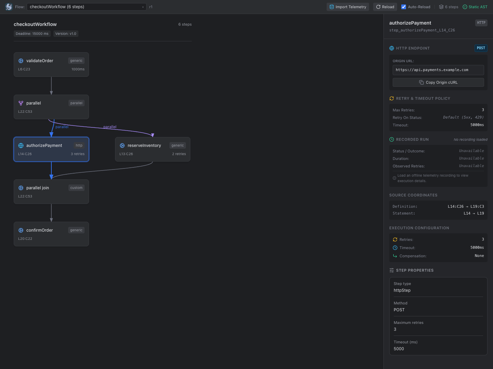
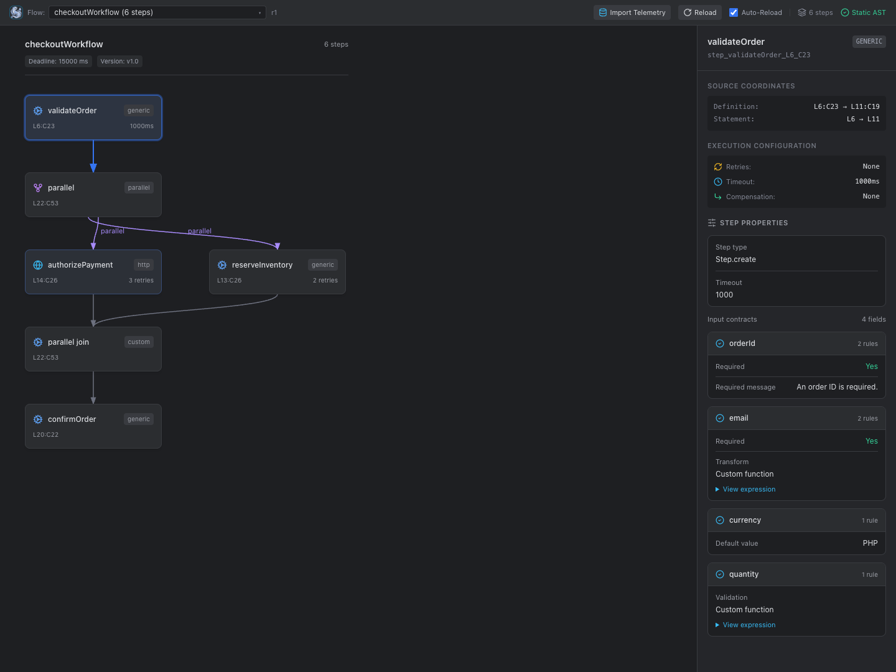
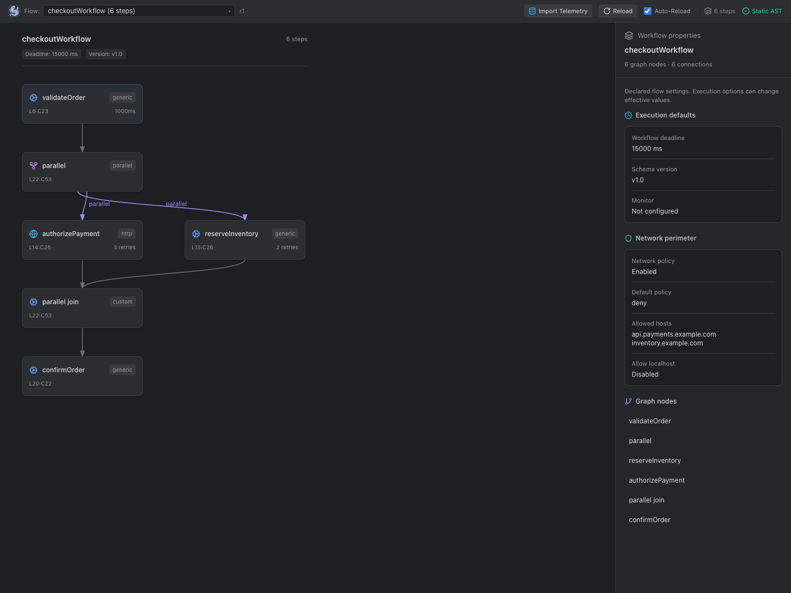
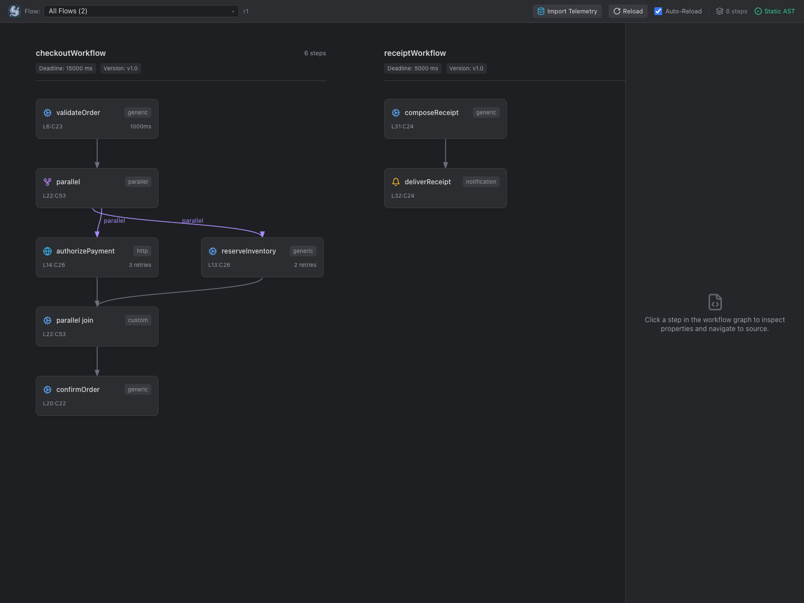
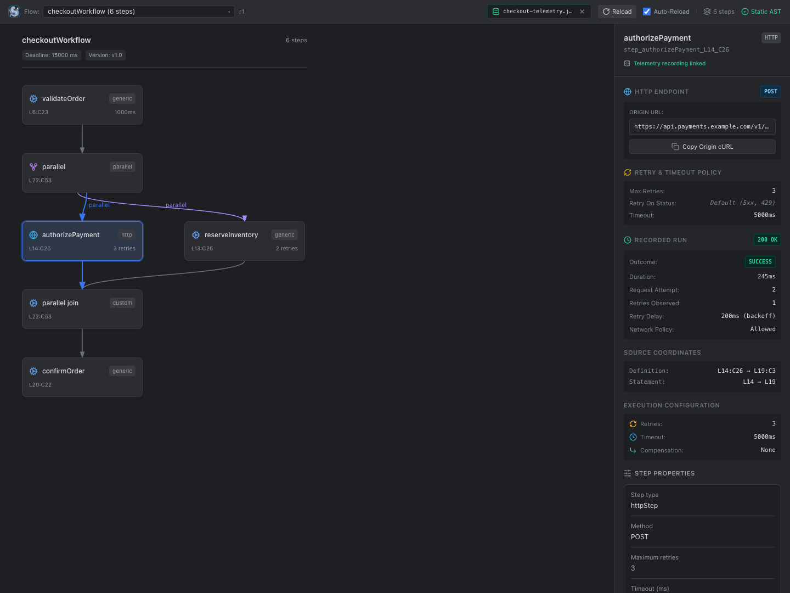
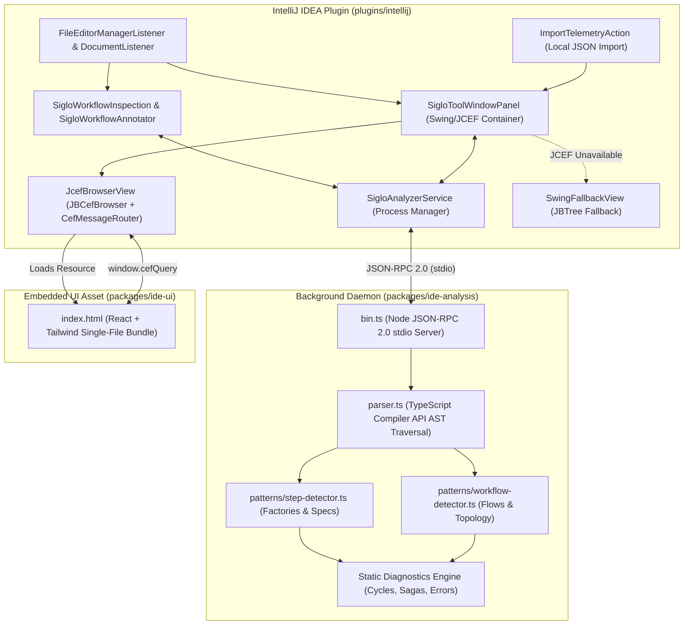

# Siglo Workflows — IntelliJ IDEA Plugin

Visual static workflow explorer, step inspector, and developer tools for [Siglo](https://github.com/jsoftgem/siglo) workflows directly inside IntelliJ IDEA.

## Getting started

1. Install the plugin ZIP through **Settings / Preferences → Plugins → gear icon → Install Plugin from Disk…**, then restart the IDE if prompted. See [Building & Installing](#5-building--installing) to generate the ZIP.
2. Open and trust your project. Ensure Node.js 18+ is available to the IDE and the analyzer is built at `packages/ide-analysis/dist/bin.js` in this repository, installed at `node_modules/@siglo/ide-analysis/dist/bin.js` in your project, or configured through `SIGLO_ANALYZER_BIN` with the absolute path to its `dist/bin.js` file.
3. Open an existing Siglo workflow, or save the example below as `hello.workflow.ts` in your project. For a project that will run the example, install the runtime with `npm install @siglo/core`; visualization reads the source without running it.
4. Right-click in the editor and choose **Visualize Siglo Workflow**, or open **View → Tool Windows → Siglo Workflows**. You should see `helloWorkflow` with two connected steps: `greet` and `formatMessage`.
5. Click `greet` to inspect its required `name` input and navigate to its definition. Change `.timeout(1000)` to `.timeout(2000)` and watch the graph update with **Auto-Reload** enabled.

```ts
import { Step, flow } from '@siglo/core';

const greet = Step.create('greet', async (input: { name: string }) => ({
  message: `Hello, ${input.name}!`,
})).spec('name', { require: true }).timeout(1000);

const formatMessage = Step.create('formatMessage', async (input: { message: string }) => ({
  message: input.message.toUpperCase(),
}));

export const helloWorkflow = flow(greet, formatMessage);
```

For the workflows shown in the screenshots, open [demo.workflow.ts](marketplace/demo.workflow.ts) and choose **All Flows**. If the graph does not appear, confirm project trust and analyzer discovery, then click **Reload**. When JCEF is unavailable, the plugin displays a native workflow tree.

## Screenshots

The following captures show the plugin's bundled webview using a statically analyzed example workflow. They exclude the surrounding IntelliJ editor.

### Workflow graph and step settings

Explore parallel paths and inspect declared retries, timeouts, and source coordinates.



### Input contracts

Review required fields, transforms, defaults, and validation rules extracted from step definitions.



### Workflow settings

Inspect the workflow deadline, schema version, and network perimeter.



### Multiple workflows

Compare workflows from the same file with the All Flows selector.



### Ecosystem telemetry & offline recordings

Inspect recorded runtime metrics, retry attempts, HTTP latencies, crypto verification categories, notification payloads, and AI token usages from imported offline recordings with fail-closed sanitization.



See [Marketplace listing assets](marketplace/README.md) for the description, screenshot captions, and capture instructions.

---

## 1. Overview & Capabilities

The **Siglo Workflows** IntelliJ plugin enables developers to visualize, inspect, and navigate complex asynchronous workflows directly within their IDE without executing user application code.

- **Visual Static Workflow Explorer**: Renders clear DAG topology layouts with longest-path layering, explicit fork/join hubs for parallel and race combinators, and styled directional edges (sequential, parallel, branch, compensation, fallback).
- **Live Debounced Typing Synchronization**: Listens for active editor document changes (`DocumentListener`) and refreshes the graph within 250ms of typing when Auto-Reload is active, using monotonic request counters to discard stale responses.
- **Bi-directional Navigation**:
  - **Graph $\rightarrow$ Code**: Clicking any step card in the visual graph navigates the IntelliJ editor to the exact line and character offset via `OpenFileDescriptor`.
  - **Code $\rightarrow$ Graph**: Switches active graph visualization automatically when switching editor tabs (`FileEditorManagerListener`).
- **Structured Step Input Contracts**: Extracts repeated `.spec(...)` and `.schema(...)` rules, grouping them into clean field cards detailing required fields, defaults, validators, transforms, and whole-input schemas.
- **Workflow-Level Configuration**: Inspects workflow deadlines (`.timeout(...)`), schema versions (`.version(...)`), network perimeter policies (`.networkPolicy(...)`), and monitor expressions with clickable workflow header badges.
- **Multi-Workflow Support**: Supports files declaring multiple workflows (e.g. `flow1`, `flow2`, and composed `flow3 = flow(flow1, flow2)`), providing an "All Flows" view with separate labeled canvases as well as individual workflow selectors.
- **Static Diagnostics & Editor Annotations**: Real-time in-editor inspection via `SigloWorkflowInspection` (`LocalInspectionTool`) and `SigloWorkflowAnnotator` (`ExternalAnnotator`). Detects and underlines DAG cycles (`SIGLO_STATIC_CYCLE`), missing compensations for sagas with side effects (`SIGLO_MISSING_COMPENSATION`), unhandled error branches in durable workflows (`SIGLO_UNHANDLED_ERROR_BRANCH`), and duplicate step IDs (`SIGLO_DUPLICATE_STEP_ID`).
- **Ecosystem Deep-Dive Inspectors & Telemetry Import**: Dedicated inspectors for HTTP, Crypto, Notifications, and AI steps. Supports importing offline telemetry JSON recordings via editor context menu (**Import Siglo Telemetry Recording...**) or tool window action to inspect recorded runtime status, latencies, token consumption, and delivery outcomes with fail-closed secret redaction.
- **Developer Execution Controls & Shortcuts**: Native run and debug workflow triggers (`SigloRunConfigurationType`), interactive durable resume with side-effect safety warnings, and keyboard shortcuts:
  - Open Visualizer: `⌃⌥V` (macOS) / `Ctrl+Alt+V` (Linux/Windows)
  - Run Workflow: `⌃⌥R` (macOS) / `Ctrl+Alt+R` (Linux/Windows)
  - Debug Workflow: `⌃⌥D` (macOS) / `Ctrl+Alt+D` (Linux/Windows)
- **Zero Application Execution**: Communicates with `@siglo/ide-analysis` over a JSON-RPC 2.0 stdio daemon using the TypeScript Compiler API. Top-level application code, database connections, and environment variables are **never** executed.
- **JCEF & Native Swing Fallback**: Renders rich interactive graphs via JCEF (`JBCefBrowser`). When running in remote development or headless environments where JCEF is unavailable, automatically falls back to a native Swing `JBTree` displaying the structured AST hierarchy.

---

## 2. Compatibility Matrix

| Dimension | Minimum Supported | Recommended Baseline | Verified Status |
|---|---|---|---|
| **IntelliJ Platform** | `2024.1` (Build 241.x) | `2024.2+` (Build 242.x / 243.x / 262.x) | ✅ Verified (Community & Ultimate) |
| **IntelliJ Editions** | Community & Ultimate | Community & Ultimate | ✅ Verified |
| **Node.js Runtime** | `18.0.0` (LTS) | `20.x` or `22.x` (Active LTS) | ✅ Node.js >= 18.0.0 |
| **TypeScript (Workspace)** | `~5.0.0` | `^5.5.0` | ✅ TypeScript 5.0+ |
| **Host JVM / Environment** | Java 17 | Java 21 | ✅ JDK 17, 21, and 25 supported (auto-managed via Daemon JVM criteria) |
| **Operating Systems** | macOS (Apple Silicon & Intel), Linux (x64), Windows 10/11 (x64) | All platforms | ✅ Cross-platform POSIX & Windows |

---

## 3. Architecture & Monorepo Integration



---

## 4. Supported Syntax & Step Ecosystem

The static analyzer extracts graph topology across core Siglo patterns and ecosystem integrations:

| Category | Supported Syntax & Patterns |
|---|---|
| **Core Steps** | `Step.create(...)`, `new Step(...)`, compatibility `Func`/`Chain` constructors and `.create(...)`, inline functions |
| **Composition** | `flow(...)`, `pipe(...)`, `Step.flow(...)`, `Step.pipe(...)`, nested flows (e.g. `flow(flow1, flow2)`), sequential arrays |
| **Combinators** | `parallel(...)`, `all(...)`, `allSettled(...)`, `race(...)`, `branch(...)`, `when(...)`, `map(...)`, static helper equivalents (`Step.parallel`, etc.) |
| **Durable Waits** | `wait(...)`, `waitForEvent(...)`, static `Step.wait(...)`, `Step.waitForEvent(...)` |
| **HTTP** | `httpStep(...)`, `new HttpStep(...)` (method, origin display, retry policy, cURL copy) |
| **AI** | `aiStep(...)`, `new AiStep(...)` (provider, model, repair policy, token metrics) |
| **Notifications** | `sendNotificationStep(...)`, `sendInteractiveApprovalStep(...)` (channel, approval state, sandboxed preview) |
| **Crypto** | `verifyWebhookStep(...)`, `encryptFieldsStep(...)`, `decryptFieldsStep(...)`, `maskFieldsStep(...)` (verification status, fail-closed redaction) |
| **Execution Options** | `.timeout(...)`, `.compensate(...)`, `.catch(...)`, `.retry(...)`, `.cache(...)`, `.idempotent(...)`, `.spec(...)`, `.schema(...)` |
| **Workflow Options** | `.timeout(...)` (workflow deadline), `.version(...)` (schema version), `.networkPolicy(...)`, `.monitor(...)` |

---

## 5. Building & Installing

### Step 1: Build Shared TypeScript Packages
From the repository root:
```bash
# 1. Build protocol schemas and run validation tests
npm test --workspace=@siglo/ide-protocol

# 2. Build static analyzer daemon and run safety & diagnostics tests
npm test --workspace=@siglo/ide-analysis

# 3. Build single-file webview bundle
npm run build --workspace=@siglo/ide-ui

# 4. Copy webview bundle into IntelliJ resources
cp packages/ide-ui/dist/index.html plugins/intellij/src/main/resources/ide-ui/index.html
```

### Step 2: Build IntelliJ Plugin Distribution
From `plugins/intellij`:
```bash
./gradlew test buildPlugin
```
*(Note: If your system default Java is JDK 25+, Gradle automatically delegates to a compatible daemon JVM via `gradle/gradle-daemon-jvm.properties` without requiring manual environment switches).*

The resulting installable ZIP distribution is located at:
`plugins/intellij/build/distributions/siglo-intellij-plugin-1.2.3.zip`

### Step 3: Install in IntelliJ IDEA
1. Open IntelliJ IDEA $\rightarrow$ **Settings / Preferences** (`⌘,` on macOS, `Ctrl+Alt+S` on Linux/Windows).
2. Navigate to **Plugins** $\rightarrow$ Click the gear icon ⚙️ $\rightarrow$ **Install Plugin from Disk...**.
3. Select `plugins/intellij/build/distributions/siglo-intellij-plugin-1.2.3.zip`.
4. Click **Restart IDE**.
5. The **Siglo Workflows** tool window will be available on the right-hand stripe.

### Step 4: Marketplace Publishing
To publish the built plugin to JetBrains Marketplace:
```bash
./gradlew publishPlugin
```
*(Requires `JETBRAINS_TOKEN` environment variable configured with your JetBrains Marketplace API key).*

---

## 6. Analyzer Daemon Discovery

When the IntelliJ plugin activates, `SigloAnalyzerService` locates the `@siglo/ide-analysis` daemon binary in the following priority order:

1. **Explicit Environment / JVM Property**:
   - `SIGLO_ANALYZER_BIN` environment variable, or
   - `siglo.analyzer.bin` JVM system property.
2. **Local Workspace Dist**:
   - `<project-root>/packages/ide-analysis/dist/bin.js`
3. **Workspace Node Modules**:
   - `<project-root>/node_modules/@siglo/ide-analysis/dist/bin.js`

Node.js itself is located by probing IDE-configured interpreters, `$PATH`, and standard version managers (`~/.nvm`, `~/.volta`, `~/.asdf`, `~/.fnm`, Homebrew).

---

## 7. Troubleshooting

### Running on JDK 25 Environments
- The project includes `gradle/gradle-daemon-jvm.properties` configured for JDK 21. If your default shell uses JDK 25 (e.g. GraalVM CE 25), Gradle automatically launches its daemon using a compatible JDK on your machine, preventing `JavaVersion.parse` errors with Kotlin DSL.
- If no compatible JDK is installed on a new machine, Gradle can auto-provision one, or you can point `JAVA_HOME` to JDK 17 or 21:
  ```bash
  export JAVA_HOME=$(/usr/libexec/java_home -v 21)
  ./gradlew test buildPlugin
  ```

### "Node.js (>= 18.0.0) is not found" Notification
- Ensure Node.js 18+ is installed on your system.
- If using NVM, ensure default alias is set (`nvm alias default <version>`) or launch IntelliJ from a shell with Node in `PATH`.
- Alternatively, configure `SIGLO_ANALYZER_BIN` pointing directly to the analyzer file path (e.g. `/path/to/dist/bin.js`, not `node /path/to/bin.js`).

### JCEF Disabled / Showing AST Tree Fallback
- Certain JetBrains runtimes (e.g. customized headless or remote development agents) disable JCEF. The plugin automatically switches to a native Swing `JBTree` view, allowing full node exploration and click-to-navigation without crashing.
- To re-enable JCEF on desktop IntelliJ, ensure you are running on the bundled JetBrains Runtime (JBR) with JCEF enabled.

### Untrusted Workspace Gate
- IntelliJ's Trusted Projects framework gates the plugin. If a project is untrusted, the background Node.js daemon will not spawn until the project is marked trusted by the user.
