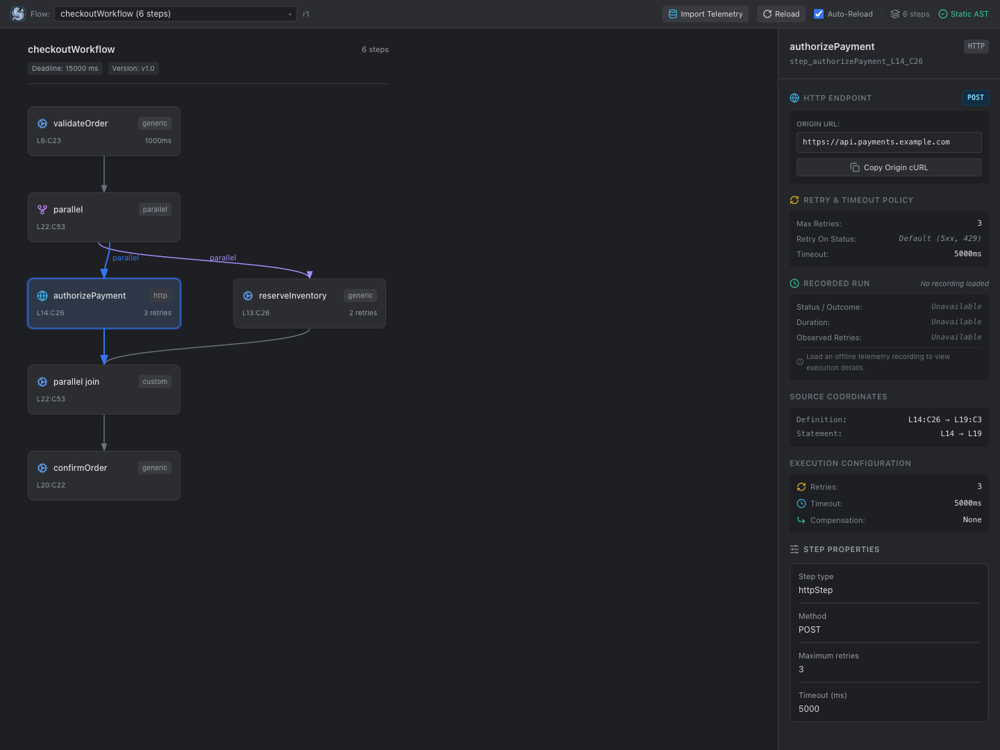
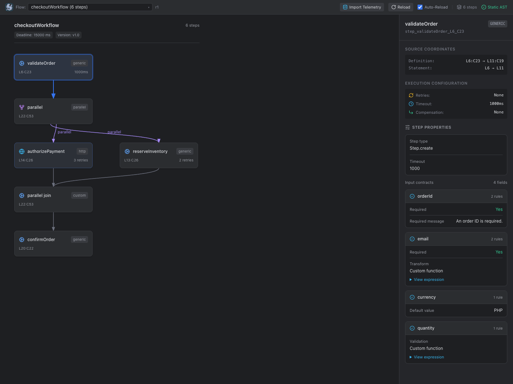
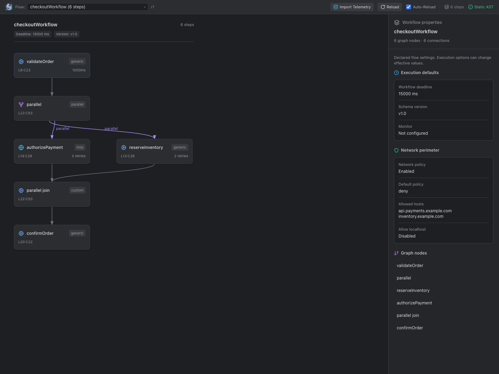
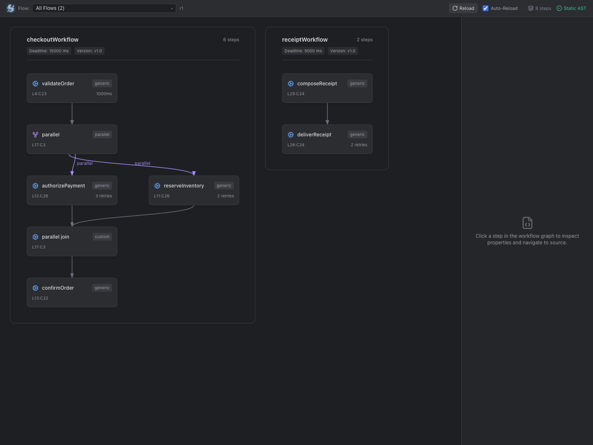
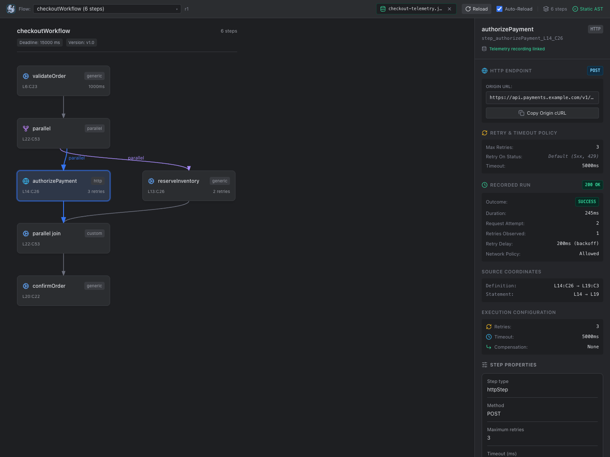

# Siglo Workflows for VS Code

See how your Siglo workflows fit together without leaving VS Code. Explore interactive graphs, inspect step inputs and settings, spot workflow problems, and jump straight to the code you need.

## Features

- **Understand the flow:** Follow sequential steps, parallel paths, conditional branches, races, compensation paths, and fallbacks. Compare workflows in the same file with **All Flows**.
- **Inspect each step:** Review required inputs, defaults, validation rules, retries, and timeouts. Inspect configuration for HTTP, AI, notification, and crypto steps.
- **Find problems while editing:** See editor diagnostics for cycles, duplicate step IDs, missing compensation, and unhandled durable error branches.
- **Move between graph and code:** Click a step to open its definition. Move your cursor into a step to highlight it in the graph.
- **Keep up with changes:** Use **Auto-Reload** to refresh the graph as you edit, or refresh manually with **Reload**.
- **Review recorded runs:** Import a local Siglo telemetry recording to inspect available execution status, retry attempts, HTTP timings, and AI token usage alongside your workflow.

## Getting started

1. Open VS Code's **Extensions** view and search for **Siglo Workflows** by **Jsoftgem**, then select **Install**.
2. Open your project folder and trust the workspace to enable workflow analysis.
3. Open a JavaScript or TypeScript file containing a Siglo workflow.
4. Open the Command Palette (`Cmd+Shift+P` on macOS or `Ctrl+Shift+P` on Windows/Linux) and run **Siglo: Open Workflow Visualizer**.
5. Select a step to inspect its inputs and settings or navigate to its source. For a sidebar view, select the **Siglo** activity bar icon and open **Siglo Workflows**.

On macOS, you can also open the visualizer with `Option+Cmd+V` while the editor has focus. Use VS Code's **Keyboard Shortcuts** editor to customize command shortcuts.

### Try a simple workflow

Save this example as `hello.workflow.ts` in your project, then open the visualizer. You should see `helloWorkflow` with two connected steps: `greet` and `formatMessage`.

```ts
import { Step, flow } from '@siglo/core';

const greet = Step.create('greet', async (input: { name: string }) => ({
  message: `Hello, ${input.name}!`,
})).spec('name', { require: true }).timeout(1000);

const formatMessage = Step.create('formatMessage', async (input: { message: string }) => ({
  message: input.message.toUpperCase(),
}));

export const helloWorkflow = flow(greet, formatMessage);
```

Select `greet` to inspect its required `name` input and timeout. Change `.timeout(1000)` to `.timeout(2000)` to see the graph update with **Auto-Reload** enabled.

The visualizer can inspect this example without running it or installing dependencies. To run the workflow in your application, install the Siglo runtime with `npm install @siglo/core`.

## Screenshots

### Workflow graph and step settings

Explore parallel paths and inspect a step's retries and timeout.



### Input contracts

Review required inputs, transforms, defaults, and validation rules.



### Workflow settings

Inspect deadlines, schema versions, and allowed network hosts.



### Multiple workflows

Compare workflows in the same source file with **All Flows**.



### Recorded execution details

Inspect available runtime metrics from an imported telemetry recording.



Try the workflows shown above with [demo.workflow.ts](marketplace/demo.workflow.ts).

## Commands

Run these commands from the Command Palette:

| Command | What it does |
| --- | --- |
| **Siglo: Open Workflow Visualizer** | Opens the graph for the active workflow source file. |
| **Siglo: Discover Workspace Workflows** | Finds workflows across your workspace folders so you can choose one to explore. |
| **Siglo: Import Telemetry Recording...** | Loads a local Siglo `.json` recording to show execution details on matching workflow nodes. |

You can also use **Import Telemetry** in the visualizer toolbar to load a recording.

## Requirements and limitations

- VS Code 1.90 or newer, running on desktop or with a remote workspace host.
- A trusted workspace containing JavaScript or TypeScript Siglo workflow source.
- No separate Node.js installation or project dependencies are needed for workflow analysis.
- Browser-only VS Code and virtual workspaces are unsupported.

Workflow analysis runs locally without importing or executing your application code. The Run tab explicitly executes exported workflows in a separate process. Values that depend on dynamic expressions may appear as unresolved. Runtime details come from imported recordings; the extension does not connect to live runtime monitors.

### Install from a VSIX file

If you have a downloaded `.vsix` file, open the **Extensions** view, select **… → Install from VSIX…**, and choose the file. Reload VS Code if prompted, then open and trust your project folder.

## Troubleshooting

- **The graph does not appear:** Confirm the workspace is trusted and the active file contains a Siglo workflow, then select **Reload**. Check **Output → Siglo** for details if analysis still fails.
- **A workflow is missing from discovery:** Discovery checks up to 100 source files and skips dependency and build folders. Open the workflow's source file directly and run **Siglo: Open Workflow Visualizer**.
- **The graph stops updating:** Enable **Auto-Reload** or select **Reload** to refresh it manually. If analysis fails, the last graph remains visible until a successful refresh.

## Run selected steps

Use the right-side **Run** tab to enter JSON, select a step or Ctrl/Cmd-click a sequential range, and execute it. View the final or intermediate output as Pretty or Raw JSON. See [execution setup and limits](../../packages/ide-runner/README.md) for exported workflows, runtime requirements, and `.siglo/run.json`.
