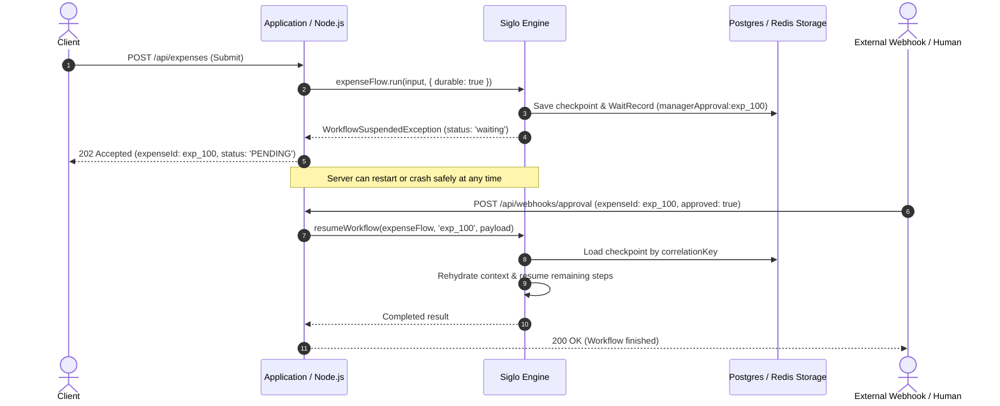

# Siglo Durable Workflows

Durable workflows allow Siglo pipelines to sleep, suspend, wait for external webhooks or human approvals, survive server restarts, and resume safely days or months later without keeping Node.js event-loop threads blocked.

---

## 1. Overview & Durable Mental Model

Unlike distributed workflow clusters that require external server daemons, Siglo executes workflows **in-process** and achieves durability by persisting execution checkpoints and wait records to an ACID storage adapter (PostgreSQL, Redis, or File storage).



---

## 2. Waiting for External Events with `waitForEvent()`

Use `waitForEvent()` to pause execution until an external event or webhook is posted.

```typescript
import { Step, flow, waitForEvent } from '@siglo/core';

export const expenseApprovalFlow = flow(
    Step.create('submitExpense', async (ctx: { expenseId: string; amount: number }) => ({
        status: 'PENDING_APPROVAL',
        submittedAt: new Date().toISOString(),
    })),

    // Workflow suspends here until 'managerApproval' event arrives
    waitForEvent('managerApproval', {
        correlationKey: ctx => ctx.expenseId, // Matches incoming resume key
        timeout: ctx => (ctx.amount > 10000 ? '24h' : '7d'), // Static DurationInput or sync DynamicDuration
    }),

    Step.create('processPayout', async (ctx: { approved: boolean; approverEmail: string; amount: number }) => {
        if (!ctx.approved) {
            return { payoutStatus: 'REJECTED' };
        }
        const transferId = await bankApi.transfer(ctx.amount);
        return { payoutStatus: 'PAID', transferId };
    }),
);
```

Both `correlationKey` and `timeout` accept static values or synchronous `(ctx) => ...` resolvers (`DynamicOption` / `DynamicDuration`) reading prior step values from `ctx`. If `timeoutMs` is set, it takes precedence over `timeout`, and non-durable runs skip evaluating `timeout(ctx)`.

### Running in Durable Mode

To activate suspension and checkpointing, pass `{ durable: true }`:

```typescript
const result = await expenseApprovalFlow.run({ expenseId: 'exp_100', amount: 1500 }, { durable: true });

console.log(result.status); // 'waiting'
console.log(result.correlationKey); // 'exp_100'
```

---

## 3. Durable Timer Sleeps with `wait()`

Pause execution for a deterministic duration without blocking Node.js threads or burning CPU memory:

```typescript
import { Step, flow, wait } from '@siglo/core';

export const onboardingDripFlow = flow(
    Step.create('sendWelcomeEmail', async (ctx: { userId: string; email: string }) => {
        await emailService.sendWelcome(ctx.email);
        return { welcomeSent: true };
    }),

    // Safely suspends for 24 hours
    wait('24h'),

    Step.create('sendFollowUpTips', async (ctx: { email: string }) => {
        await emailService.sendTips(ctx.email);
        return { followUpSent: true };
    }),
);
```

`wait()` accepts a `DynamicDuration` (`number | string | ((ctx) => number | string)`), so you can pass static values like `'24h'` or synchronous context resolvers like `wait(ctx => ctx.cooldown)`.

Supported duration strings include `'100ms'`, `'30s'`, `'15m'`, `'24h'`, `'7d'`.

---

## 4. Resuming Suspended Workflows

When the external webhook or approval arrives, resume execution with `resumeWorkflow()`:

```typescript
import { resumeWorkflow } from '@siglo/core';
import { expenseApprovalFlow } from './workflows';

app.post('/api/webhooks/expenses/approval', async (req, res) => {
    const { expenseId, approved, approverEmail } = req.body;

    try {
        const finalResult = await resumeWorkflow(
            expenseApprovalFlow,
            expenseId, // The correlationKey defined in waitForEvent
            { approved, approverEmail }, // Event payload merged into context
            { pojo: true },
        );

        res.json({ success: true, result: finalResult });
    } catch (err: any) {
        if (err.name === 'ExpiredWaitException') {
            res.status(410).json({ error: 'Approval request expired' });
        } else {
            res.status(500).json({ error: err.message });
        }
    }
});
```

---

## 5. Persistence Adapters

### 1. PostgreSQL Adapter (`@siglo/postgres`)

Enterprise ACID-compliant persistence with Optimistic Concurrency Control (OCC) and advisory locking.

```typescript
import { Pool } from 'pg';
import { useStorage } from '@siglo/core';
import { PostgresStorageAdapter, PostgresIdempotencyStore } from '@siglo/postgres';

const pool = new Pool({ connectionString: process.env.DATABASE_URL });

export const storageAdapter = new PostgresStorageAdapter({
    client: pool,
    checkpointsTable: 'siglo_checkpoints',
    eventsTable: 'siglo_events',
    waitRecordsTable: 'siglo_waits',
});

// Register globally for the application
useStorage(storageAdapter);
```

### 2. Redis Adapter (`@siglo/redis`)

High-throughput distributed storage and locking powered by Redis or Redis Cluster.

```typescript
import Redis from 'ioredis';
import { useStorage } from '@siglo/core';
import { RedisStorageAdapter, RedisIdempotencyStore, RedisLock } from '@siglo/redis';

const redis = new Redis(process.env.REDIS_URL);

export const storageAdapter = new RedisStorageAdapter({
    client: redis,
    keyPrefix: 'siglo:prod:',
    defaultTtlSeconds: 86400 * 30, // 30 days
});

useStorage(storageAdapter);
```

---

## 6. Optimistic Concurrency Control (OCC) & Race Conditions

When multiple worker nodes attempt to resume or mutate the same workflow simultaneously, Siglo enforces versioned OCC:

1. Every checkpoint carries an internal version number (`version: 1, 2, ...`).
2. When saving an updated checkpoint, Siglo validates that the database version matches the in-memory version.
3. If a concurrent worker committed first, Siglo throws `CheckpointConflictException`.

### Handling OCC Conflicts

With PostgreSQL, use `storageAdapter.withWorkflowLock(stackId, async () => { ... })` to wrap resumption endpoints in advisory locks:

```typescript
await storageAdapter.withWorkflowLock(expenseId, async () => {
    return await resumeWorkflow(expenseApprovalFlow, expenseId, payload);
});
```

---

## 7. Workflow Versioning & Zero-Downtime State Migrations

Workflows sleeping for weeks may encounter code releases before resumption. Siglo allows safe state migrations:

```typescript
import { flow, StateMigrationFn } from '@siglo/core';

// Migration handler from v1 checkpoint format to v2
const migrateV1toV2: StateMigrationFn = (oldContext, fromVersion) => {
  if (fromVersion === '1.0.0') {
    return {
      ...oldContext,
      amountCents: Math.round(oldContext.amount * 100), // Converted dollars to cents
    };
  }
  return oldContext;
};

export const expenseFlow = flow(...)
  .version('2.0.0', {
    migrations: {
      '1.0.0': migrateV1toV2,
    },
  });
```

---

## 8. Golden Rules for Durable Workflows

1. **Deterministic Correlation Keys**: Choose immutable, unique business keys (e.g. `orderId`, `expenseId`, `invoiceNumber`) as correlation keys. Never use random ephemeral timestamps.
2. **Explicit Timeouts**: Always specify a `timeout` (e.g. `'7d'`, `'30d'`) on `waitForEvent` to prevent orphaned wait records in storage.
3. **Store Credentials Outside Context**: Keep secret API keys in environment variables; do not store credentials in durable workflow state.
4. **Use Advisory Locks on Webhooks**: Guard resume webhook handlers with distributed or advisory locks to prevent concurrent race conditions.
5. **Clean Expired Checkpoints**: Schedule periodic cleanup using `storageAdapter.cleanExpiredCheckpoints()` to maintain fast database queries.
