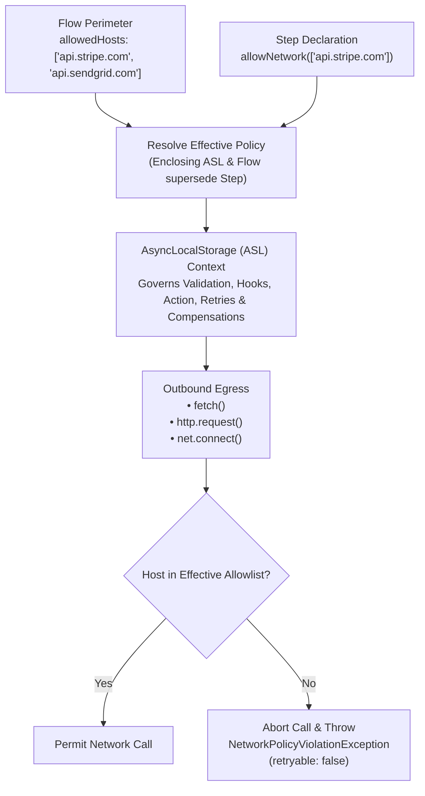

# Siglo Security and Guardrails

In modern microservices and agentic pipelines, workflow steps frequently handle untrusted inputs, PII, payment tokens, and external third-party APIs. Without rigorous guardrails, malicious payloads or compromised dependencies can exfiltrate secrets, communicate with unauthorized servers, or establish unmonitored raw sockets.

**Siglo** provides an **in-process zero-trust security perimeter** enforced using Node's standard `AsyncLocalStorage` (ASL). It isolates network egress per step and branch with zero external proxies or sidecars, and pairs with `@siglo/crypto` for authenticated field encryption and timing-safe webhook verification.

---

## 1. Zero-Trust Network Mental Model

Siglo's network governance follows five fundamental principles:

1. **Policy Activation & Default Deny**: When a network policy is attached to a flow or step, egress enforcement activates and defaults to blocking all external outbound network connections unless explicitly listed in an allowlist.
2. **Outer Envelope Narrowing (Flow Supersedes Step)**: The `Flow` (or enclosing execution scope) defines the maximum allowable security perimeter. Steps and nested subflows can only **narrow** permissions within what the outer envelope permits (e.g. Flow allows `['api.stripe.com', 'api.sendgrid.com']`, Step narrows to `['api.stripe.com']`). A Step can never expand or bypass the Flow perimeter.
3. **Multi-Layer Interception**: Siglo intercepts egress across three distinct runtime layers:
    - Global Fetch: `globalThis.fetch` (Undici / standard Fetch API)
    - Node HTTP/HTTPS: `node:http` and `node:https` (`request`, `get`, Axios, Got)
    - Raw Sockets: `node:net.Socket.prototype.connect` and `node:tls`
4. **Localhost & Unix Socket Controls**: Loopback addresses (`127.0.0.1`, `localhost`, `::1`) are blocked by default unless `allowLocalhost: true` is configured. Local domain sockets (e.g. `/var/run/docker.sock`) are blocked unless specified in `allowUnixSockets`.
5. **Zero Concurrency Cross-Talk & ASL Inheritance**: Network boundaries propagate via Node's `AsyncLocalStorage` (`networkPolicyStorage`). Concurrent steps executing in `parallel`, `race`, or `map` maintain strictly isolated perimeters without leaking permissions across branches. Nested subflows, combinators, and Saga compensation rollbacks automatically inherit and intersect enclosing policies.



---

## 2. Declarative Step Guardrails

### `step.allowNetwork(hosts)`

Permits specific hostnames, wildcard subdomains, port combinations, or regular expressions during step execution:

```typescript
import { Step } from '@siglo/core';

export const callStripe = Step.create('chargeCustomer', async ({ amount, token }) => {
    const res = await fetch('https://api.stripe.com/v1/charges', {/* ... */});
    return res.json();
}).allowNetwork(['api.stripe.com', '*.stripe.network']);
```

Allowed host formats:

- Specific domain: `'api.stripe.com'`
- Wildcard subdomain: `'*.stripe.com'` (matches `api.stripe.com`, `auth.stripe.com`)
- Explicit port: `'internal-service:8080'`
- RegExp pattern: `/^api\.(internal|partner)\.com$/`

### `step.denyNetwork()`

Shorthand for `.allowNetwork([])`. Strictly denies **all** outbound network egress across all lifecycle phases (validation specs, `onBefore`, `action`, `onAfter`, and retries):

```typescript
export const computeTax = Step.create('computeTax', async ({ subtotal }) => {
    // Pure computation step: guaranteed zero outbound network calls
    return { tax: subtotal * 0.08 };
}).denyNetwork();
```

### `step.allowUnixSockets(sockets)`

Explicitly permits communication over specified local Unix domain sockets (IPC filesystem paths):

```typescript
export const queryLocalDaemon = Step.create('inspectContainer', async () => {
    return await queryDockerDaemon('/var/run/docker.sock');
}).allowUnixSockets(['/var/run/docker.sock']);
```

### `step.networkPolicy(policy)`

Configures full granular network egress policies for a step:

```typescript
export const syncGithub = Step.create('syncGithub', async () => {
    return await fetch('https://api.github.com/user');
}).networkPolicy({
    allowedHosts: ['api.github.com'],
    defaultPolicy: 'deny',
    allowLocalhost: true, // Allow local database or sidecar access
    allowUnixSockets: ['/tmp/app.sock'],
});
```

---

## 3. Flow Security Perimeters & ASL Inheritance

Set the outer perimeter across an entire workflow using `flow.networkPolicy()` or `flow.run(input, { networkPolicy })`:

```typescript
import { flow } from '@siglo/core';

export const billingWorkflow = flow(validateInput, computeTotals, chargeCard, sendReceipt).networkPolicy({
    allowedHosts: ['api.stripe.com', 'api.sendgrid.com'],
    defaultPolicy: 'deny',
    allowLocalhost: false,
});
```

### Perimeter Narrowing Rules

- **Narrowing Allowed**: If the Flow allows `['api.stripe.com', 'api.sendgrid.com']`, an individual Step can narrow its access to `['api.stripe.com']`.
- **Widening Denied**: If a Step attempts to allow `api.unauthorized.com`, Siglo rejects the request with `NetworkPolicyViolationException` because the Flow perimeter does not permit that host.
- **Pure Computation**: A Step declared with `.denyNetwork()` within an open Flow strictly denies network calls for that step.
- **Nested Combinators & Sub-flows**: Any nested `parallel`, `branch`, `map`, or `Step.create(subFlow)` intersects its policy with the enclosing `networkPolicyStorage` store, guaranteeing child steps cannot widen an outer flow's boundary.
- **Saga Compensation Rollback Perimeter**: Both automatic rollbacks and checkpoint-hydrated `flow.compensate(stackId)` restore and execute compensation handlers inside the effective captured network policy, ensuring compensation calls cannot contact unapproved external endpoints.

---

## 4. Handling `NetworkPolicyViolationException`

When an unauthorized network request is attempted, Siglo aborts the request immediately before socket creation and throws `NetworkPolicyViolationException`:

```typescript
import { NetworkPolicyViolationException } from '@siglo/core';

try {
    await billingWorkflow.run(input);
} catch (err) {
    if (err instanceof NetworkPolicyViolationException) {
        console.error(`Blocked egress to ${err.host}:${err.port}`);
        console.error(`Triggered during step "${err.metadata.stepName}" in phase "${err.phase}"`);
        // err.phase: 'before' | 'action' | 'after' | 'validation'
        // err.retryable === false
    }
}
```

> [!NOTE]
> `NetworkPolicyViolationException` is **non-retryable by default** (`err.retryable = false`). Retrying will not bypass policy rules and prevents wasting system resources.

---

## 5. Cryptographic Protection with `@siglo/crypto`

Pair network guardrails with `@siglo/crypto` to encrypt sensitive state and verify incoming webhooks. Options support synchronous `DynamicOption` resolvers reading from `ctx` (e.g. per-tenant keys, AAD).

### 1. Authenticated Field-Level Envelope Encryption (AEAD AES-256-GCM)

Encrypt credit cards, API keys, or PII before persisting durable checkpoints or emitting logs. Support dynamic per-tenant Additional Authenticated Data (`aad`) and HKDF subkey context (`deriveKeyContext`):

```typescript
import { flow } from '@siglo/core';
import { encryptFieldsStep, decryptFieldsStep } from '@siglo/crypto';

export const secureCheckoutFlow = flow(
    // 1. Encrypt sensitive fields in context with tenant-isolated AAD
    encryptFieldsStep('encryptSensitiveData', {
        fields: ['cardNumber', 'cvv', 'ssn'],
        secretKey: process.env.ENCRYPTION_MASTER_KEY!, // 256-bit AES key (or async KeyRing resolver)
        aad: ctx => `tenant:${ctx.tenantId}`, // DynamicOption: binds AEAD auth tag to tenant
        deriveKeyContext: ctx => `checkout:${ctx.tenantId}`, // DynamicOption: HKDF subkey derivation
    }),

    // 2. Durable wait or external storage (safe from plaintext leakage)
    durableWaitStep,

    // 3. Decrypt fields only when required by downstream authorized processor
    decryptFieldsStep('decryptSensitiveData', {
        fields: ['cardNumber', 'cvv', 'ssn'],
        secretKey: process.env.ENCRYPTION_MASTER_KEY!,
        aad: ctx => `tenant:${ctx.tenantId}`,
        deriveKeyContext: ctx => `checkout:${ctx.tenantId}`,
    }),
);
```

### 2. Timing-Safe Webhook Signature Verification

Protect webhook endpoints against timing attacks and replay attacks with automatic tolerance window checks:

```typescript
import { flow } from '@siglo/core';
import { verifyWebhookStep } from '@siglo/crypto';

export const stripeWebhookFlow = flow(
    verifyWebhookStep('verifyStripe', {
        provider: 'stripe', // Or DynamicOption (ctx => ctx.webhookProvider)
        secret: ctx => ctx.tenantWebhookSecret, // DynamicOption reading secret from ctx
        payload: ctx => ctx.rawBody, // Synchronous request extractor
        signature: ctx => ctx.headers['stripe-signature'], // Synchronous request extractor
        toleranceSeconds: 300, // 5-minute replay attack tolerance window
    }),
    processWebhookEvent,
);
```

---

## 6. Context Privacy and Redaction

1. **Redact Sensitive Fields with `onAfter`**:
   Cleanse temporary tokens before they are merged into the accumulated context:

    ```typescript
    const authenticate = Step.create('auth', async () => {
        const token = await authService.login();
        return { sessionToken: token, userId: 'u_123' };
    }).onAfter(output => ({
        userId: output.userId, // Drop sessionToken from accumulated context
    }));
    ```

2. **Strict Output Filtering with `step.reduce(field)`**:
   Avoid polluting workflow context with raw provider responses:

    ```typescript
    const chargeCard = Step.create('charge', async () => {
        const stripeCharge = await stripe.charges.create({/* ... */});
        return stripeCharge.id;
    }).reduce('chargeId'); // Only context.chargeId is preserved
    ```

3. **Sanitize External Boundaries with `pojo: true`**:
   Always pass `{ pojo: true }` when exposing workflows via REST APIs to unwrap reactive proxy symbols and private engine fields.

---

## 7. Golden Rules for Secure Workflows

1. **Default Deny on Critical Flows**: Always declare `flow.networkPolicy({ defaultPolicy: 'deny', allowedHosts: [...] })` on payment, authentication, or PII pipelines.
2. **Enforce Step Least-Privilege**: Narrow each step to only the exact domains it needs (`step.allowNetwork(['api.vendor.com'])`).
3. **Deny Pure Computational Steps**: Explicitly chain `.denyNetwork()` on data parsing, validation, transformation, or arithmetic steps.
4. **Never Expand Flow Perimeters**: Remember that inner steps, combinators, and subflows cannot grant access to hosts forbidden by the outer flow or enclosing ASL storage scope.
5. **Encrypt Before Checkpointing**: Use `encryptFieldsStep` with dynamic `aad` before durable wait nodes to protect customer data at rest.
6. **Enforce Replay Attack Tolerance**: Always configure `toleranceSeconds` on `verifyWebhookStep` to prevent replay attacks.
