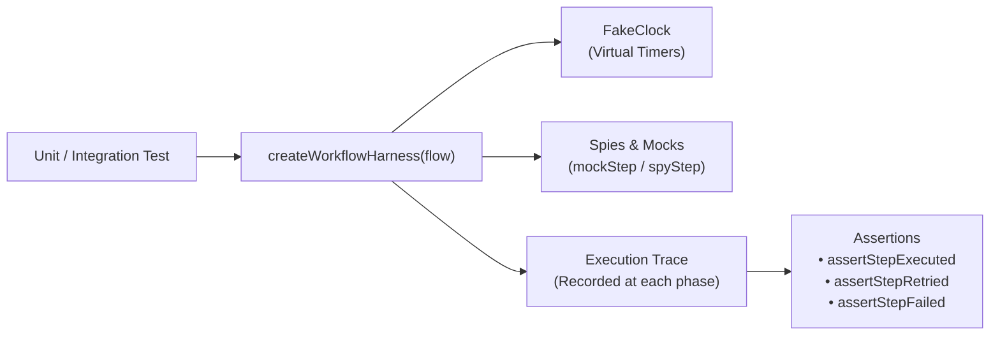

# Siglo Testing and Replay

`@siglo/testing` provides a comprehensive, zero-flake test harness for Siglo workflows. It allows teams to mock external steps, spy on intermediate context, advance virtual clocks without `setTimeout` delays, assert retry and failure behavior, and replay production failure recordings locally in CI.

---

## 1. Overview & Test Mental Model

Workflows coordinate multiple steps with retries, timeouts, and compensations. Traditional end-to-end tests for such pipelines are notoriously slow and flaky due to wall-clock sleeps and network dependencies.

With `@siglo/testing`:

1. **Isolated Execution**: `createWorkflowHarness` wraps your workflow in a sandbox with isolated in-memory storage and trace logging.
2. **Deterministic Time**: `FakeClock` advances virtual timestamps instantly, validating exponential backoff and timeouts in milliseconds.
3. **Targeted Mocking**: Replace only external boundary steps with `mockStep()` while executing all internal flow logic, branching, and validations naturally.
4. **Saga Verification**: Easily test that failing a step correctly triggers upstream compensations in reverse LIFO order.



---

## 2. Setting Up the Workflow Harness

Wrap any Siglo `Flow` in `createWorkflowHarness`:

```typescript
import { createWorkflowHarness } from '@siglo/testing';
import { orderFlow } from './order.flow';

const harness = createWorkflowHarness(orderFlow, {
    services: {
        db: mockDatabase,
    },
});

const result = await harness.run({
    orderId: 'ord-100',
    sku: 'WIDGET-1',
    amountCents: 2500,
});
```

---

## 3. Step Mocking

Replace external third-party calls (payment gateways, notification APIs, LLMs) without editing workflow code:

```typescript
// Replace Stripe call with a deterministic success mock
harness.mockStep('chargePayment', async param => {
    return { chargeId: 'ch_mock_123', status: 'PAID' };
});

// Or simulate a transient 503 gateway failure
let attempts = 0;
harness.mockStep('callExternalApi', async () => {
    attempts++;
    if (attempts < 3) {
        const err: any = new Error('Gateway Unavailable');
        err.status = 503;
        throw err;
    }
    return { success: true };
});
```

---

## 4. Spies and Built-in Assertions

### Spying on Inputs and Outputs

```typescript
const spy = harness.spyStep('reserveInventory');

await harness.run({ orderId: 'ord-100', sku: 'ITEM-1' });

console.log(spy.called); // true
console.log(spy.callCount); // 1
console.log(spy.firstCall()?.input); // { orderId: 'ord-100', sku: 'ITEM-1' }
console.log(spy.firstCall()?.output); // { reservationId: 'res-1' }
```

### Built-in Harness Assertions

```typescript
// Assert a step executed exactly N times (or at least once if omitted)
harness.assertStepExecuted('validateOrder', 1);

// Assert a step retried due to transient errors
harness.assertStepRetried('chargePayment', 2);

// Assert a step failed with a matching error message or regex
harness.assertStepFailed('chargePayment', /declined/i);
```

---

## 5. Virtual Timers with `FakeClock`

Test exponential backoff retries and timeouts without waiting for real wall-clock delays:

```typescript
import { FakeClock, createWorkflowHarness } from '@siglo/testing';
import { retryWorkflow } from './retry.flow';

const clock = new FakeClock(1000);
const harness = createWorkflowHarness(retryWorkflow, { clock });

// Advance virtual clock by 5000 milliseconds
clock.advanceTime(5000);

// Advance virtual clock and flush microtask queue
await clock.tick(1000);
```

---

## 6. Testing Sagas and Compensation Rollbacks

Verify that when a downstream step fails, prior steps are refunded or released in strict LIFO order:

```typescript
import assert from 'node:assert/strict';
import { createWorkflowHarness } from '@siglo/testing';
import { createOrderFulfillmentFlow } from './order-fulfillment';

const events: string[] = [];

const services = {
    inventory: {
        reserve: async () => {
            events.push('reserve-stock');
            return 'res-1';
        },
        release: async () => {
            events.push('release-stock');
        },
    },
    payment: {
        charge: async () => {
            events.push('charge-card');
            return 'ch-1';
        },
        refund: async () => {
            events.push('refund-charge');
        },
    },
    shipping: {
        dispatch: async () => {
            events.push('dispatch-shipping');
            throw new Error('Carrier service unavailable'); // Trigger failure
        },
    },
};

const flow = createOrderFulfillmentFlow(services);
const harness = createWorkflowHarness(flow);

// Workflow should reject
await assert.rejects(
    harness.run({ orderId: 'ord-1', sku: 'ITEM-A', amountCents: 5000 }),
    /Carrier service unavailable/,
);

// Verify Sagas unwound in reverse LIFO order:
// 1. reserve-stock -> 2. charge-card -> 3. dispatch-shipping (fails) -> 4. refund-charge -> 5. release-stock
assert.deepEqual(events, ['reserve-stock', 'charge-card', 'dispatch-shipping', 'refund-charge', 'release-stock']);
```

---

## 7. Execution Trace Snapshots & Failure Replay

Capture execution traces from staging or production and replay them in automated test suites:

### 1. Exporting an Execution Record

```typescript
const record = harness.exportExecutionRecord({
    excludeKeys: ['password', 'token'], // Sanitize secrets
});
fs.writeFileSync('test/fixtures/order-failure.json', JSON.stringify(record, null, 2));
```

### 2. Replaying a Fixture

```typescript
import { replayExecution } from '@siglo/testing';
import failureFixture from './fixtures/order-failure.json';

const replayResult = await replayExecution(failureFixture, orderFlow, {
    substituteFixtures: {
        // Optionally mock flaky steps during replay
        callExternalService: { status: 'OK' },
    },
});

assert.ok(replayResult.matched, `Discrepancies found: ${replayResult.discrepancies.join(', ')}`);
```

---

## 8. Golden Rules for Workflow Testing

1. **Test the Happy Path First**: Verify end-to-end accumulated context shape with `pojo: true`.
2. **Explicitly Test Compensation Chains**: For every step with `.compensate()`, write a test where the _next_ step fails and assert the compensation fired.
3. **Simulate Retry Recovery**: Mock a step to throw twice and succeed on attempt 3; verify `assertStepRetried()`.
4. **Use FakeClock for Timeouts**: Never use `setTimeout` or `sleep` in unit tests; use `FakeClock`.
5. **Sanitize Golden Fixtures**: When saving execution traces for regression replay, ensure credit cards and auth headers are stripped.
