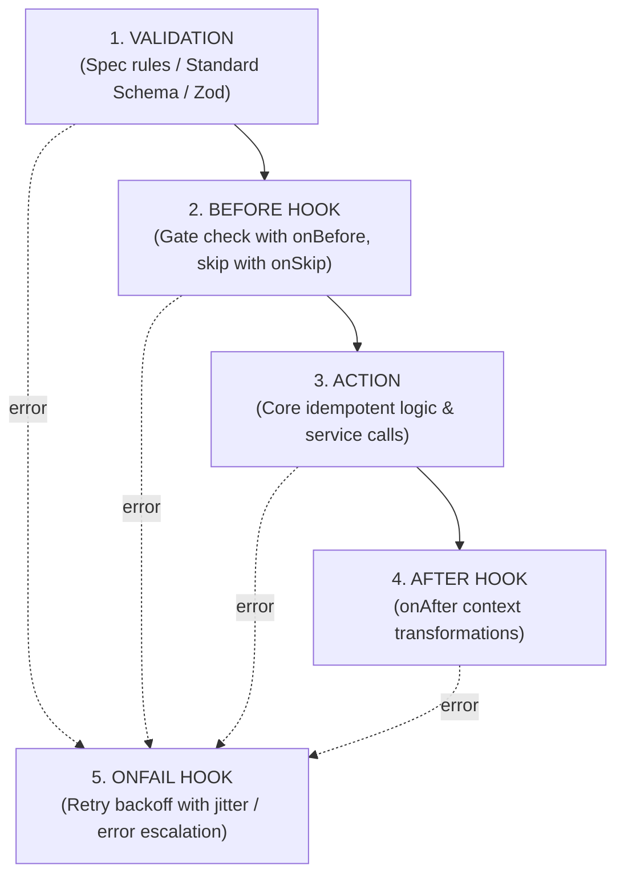

# Siglo Workflow Development

Siglo is a lightweight, zero-daemon, in-process workflow runtime for TypeScript. It turns complex business logic into composable, resilient pipelines with end-to-end static type inference, automatic Sagas, retry backoff with jitter, and live DevTools without requiring external server daemons or queue clusters.

---

## 1. Core Architecture & Mental Model

### Declarative AST & Flattened DAG

A Siglo workflow is not a fragile promise chain. When declared, it forms an Abstract Syntax Tree (AST) of nodes (`toGraph()`) that flattens into a Directed Acyclic Graph (DAG) for cycle detection, linting, and visualization (`toMermaid()`).

### Accumulated Context Inference

In a sequential `flow(stepA, stepB, stepC)`:

1. Every step returns an object whose properties merge into the **Accumulated Context**.
2. Subsequent steps statically receive the union of all prior outputs without manual passing.
3. Access historical outputs isolated by step name using `param.$steps.<stepName>` or `param.$steps('<stepName>')`.

```typescript
import { Step, flow } from '@siglo/core';

interface OrderInput {
    orderId: string;
    sku: string;
    amountCents: number;
}

const validateOrder = Step.create('validateOrder', (order: OrderInput) => {
    if (order.amountCents <= 0) throw new Error('Order amount must be positive');
    return { validated: true };
});

const reserveInventory = Step.create('reserveInventory', async ({ sku }: { sku: string }) => {
    const reservationId = await inventoryService.reserve(sku);
    return { reservationId };
}).compensate(async ({ reservationId }) => {
    await inventoryService.release(reservationId);
});

const chargeCard = Step.create(
    'chargeCard',
    async ({ orderId, amountCents }: { orderId: string; amountCents: number }) => {
        const chargeId = await paymentGateway.charge(orderId, amountCents);
        return { chargeId };
    },
)
    .onFail({
        maxRetries: 3,
        delay: 150,
        backoff: 'exponential',
        jitter: true,
        retryIf: err => err.isTransient === true,
    })
    .compensate(async ({ chargeId }) => {
        await paymentGateway.refund(chargeId);
    });

export const orderFulfillmentFlow = flow(validateOrder, reserveInventory, chargeCard);
```

---

## 2. The 5-Phase Step Lifecycle

Every step executes through a strict 5-phase lifecycle:



### 1. Validation (`.spec()` or Standard Schema)

Validates inputs before entering action logic. Rejections throw `ValidationException` (non-retryable by default).

```typescript
import { z } from 'zod';

const OrderSchema = z.object({
    orderId: z.string().min(1),
    quantity: z.number().int().positive(),
});

const validateStep = Step.create('validate', handler).schema(OrderSchema); // Standard Schema compatible
```

### 2. Before Hook & Conditional Skipping (`.onBefore()`, `.onSkip()`)

Determines whether to execute the action or bypass it:

```typescript
const applyDiscount = Step.create('applyDiscount', async ({ orderId, couponCode }) => {
    return { discountCents: 1000 };
})
    .onBefore(ctx => Boolean(ctx.couponCode))
    .onSkip(() => ({ discountCents: 0 }));
```

### 3. Action (`Step.create(name, fn)`)

The core asynchronous business logic. Output keys merge into context.

### 4. After Hook (`.onAfter()`)

Transform or redact step outputs before context merge:

```typescript
const fetchCustomer = Step.create('fetchCustomer', async ({ customerId }) => {
    return await customerApi.get(customerId);
}).onAfter(result => ({
    ...result,
    emailMasked: result.email.replace(/(.{2})(.*)(@.*)/, '$1***$3'),
}));
```

### 5. OnFail Hook & Retries (`.onFail()`)

Handles retries with configurable backoff curves and jitter:

```typescript
step.onFail({
    maxRetries: 3, // Total retry attempts
    delay: 200, // Initial delay in ms
    backoff: 'exponential', // 'fixed' | 'linear' | 'exponential'
    factor: 2, // Exponential multiplier
    maxDelay: 5000, // Maximum delay cap in ms
    jitter: true, // Adds full random jitter to prevent thundering herds
    retryIf: error => error.status >= 500, // Conditional predicate
});
```

---

## 3. Sagas & Automated Compensations

Siglo provides built-in Saga orchestration with **LIFO (Last-In, First-Out)** rollback order.

### How Compensations Work

1. When a step with `.compensate()` completes successfully, its compensation record is pushed onto the workflow's execution stack.
2. If any subsequent step fails (after exhausting retries) or if the workflow is cancelled, Siglo unwinds the stack in reverse order.
3. Each compensation handler receives the output produced by its corresponding step.

```typescript
const bookFlight = Step.create('bookFlight', async ({ passengerId }) => {
    const ticketId = await airlineApi.book(passengerId);
    return { ticketId };
}).compensate(async ({ ticketId }) => {
    await airlineApi.cancel(ticketId);
});

const bookHotel = Step.create('bookHotel', async ({ hotelId }) => {
    const bookingId = await hotelApi.reserve(hotelId);
    return { bookingId };
}).compensate(async ({ bookingId }) => {
    await hotelApi.cancel(bookingId);
});

// If bookRentalCar throws, bookHotel is compensated first, then bookFlight
export const travelFlow = flow(bookFlight, bookHotel, bookRentalCar);
```

> [!IMPORTANT]
> If a compensation itself throws an error, Siglo captures it as `UnresolvableCompensationException` and records a dead-letter compensation record. Ensure compensation handlers are idempotent and handle missing IDs gracefully.

---

## 4. Workflow Combinators

Siglo provides first-class functional combinators for concurrency, racing, branching, and bounded batch mapping.

### 1. Parallel Fan-Out (`parallel()`)

Executes branches concurrently and merges outputs:

```typescript
import { Step, flow, parallel } from '@siglo/core';

export const kycPipeline = flow(
    parallel([verifyIdentity, checkSanctionsList, evaluateCreditScore], {
        mode: 'fail-fast', // 'fail-fast' | 'allSettled'
        mergeStrategy: 'shallow', // 'shallow' | 'deep' | 'namespace'
    }),
    decideOnboarding,
);
```

### 2. Competitive Racing (`race()`)

Executes alternatives concurrently; first to complete wins, others are ignored:

```typescript
import { flow, race } from '@siglo/core';

export const fetchFastPrice = flow(race([queryPrimaryDatabase, queryFastReplicaCache]));
```

### 3. Boolean Branching (`when()`)

Binary conditional execution:

```typescript
import { flow, when } from '@siglo/core';

export const orderApproval = flow(
    when(
        ctx => ctx.totalAmount > 10000,
        flagForManualReview, // Then branch
        autoApproveOrder, // Else branch (optional)
    ),
);
```

### 4. Multi-Way Routing (`branch()`)

Dictionary dispatch based on string selector:

```typescript
import { flow, branch } from '@siglo/core';

export const routeNotification = flow(
    branch(
        ctx => ctx.preferredChannel, // Selector returning route key
        {
            email: sendEmailStep,
            sms: sendSmsStep,
            slack: sendSlackStep,
        },
        sendEmailStep, // Default fallback branch
    ),
);
```

### 5. Bounded Batch Processing (`map()`)

Processes arrays with bounded concurrency, avoiding memory explosions and rate limits:

```typescript
import { flow, map } from '@siglo/core';

const processItem = Step.create('processItem', async (item: OrderItem) => {
    return await warehouse.reserve(item.sku, item.qty);
});

export const processOrderItems = flow(
    map(
        ctx => ctx.items, // Accessor returning array
        processItem, // Step or Flow executed per item
        {
            concurrency: 5, // Max concurrent in-flight items
            stopOnError: true, // Halt immediately on first failure
            preserveOrder: true, // Preserve original array index ordering
        },
    ),
);
```

---

## 5. Idempotency & Caching

### In-Process & Distributed Idempotency

Prevent duplicate execution using `.idempotent()`:

```typescript
const processPayment = Step.create('processPayment', async ({ paymentId, amount }) => {
    return await stripe.charges.create({ amount });
}).idempotent({
    keyBuilder: ctx => `payment:${ctx.paymentId}`,
    ttlMs: 3600_000, // 1 hour claim window
});
```

### Step Output Caching

Cache deterministic expensive calls:

```typescript
const fetchTaxRates = Step.create('fetchTaxRates', async ({ countryCode }) => {
    return await taxApi.lookup(countryCode);
}).cache({
    ttlMs: 300_000, // Cache for 5 minutes
    keyBuilder: ctx => `tax:${ctx.countryCode}`,
});
```

---

## 6. Running & Inspecting Workflows

### Execution Options

```typescript
const result = await orderFulfillmentFlow.run(
    { orderId: 'ord-123', sku: 'SKU-A', amountCents: 5000 },
    {
        pojo: true, // Strips internal proxies and getters into a plain object
        timeout: 10_000, // Flow-level timeout in ms
        namespace: 'ecommerce', // Logical domain partitioning for logs and DevTools
        services: {
            // Dependency injection available in step hooks
            db: pool,
        },
    },
);
```

### Visualizing Workflows

Generate Mermaid diagrams directly for documentation, PR descriptions, or debugging:

```typescript
const mermaidDiagram = orderFulfillmentFlow.toMermaid();
console.log(mermaidDiagram);
```

### CLI Scaffolding

Using `@siglo/cli`:

```bash
# Initialize a new Siglo project structure
npx siglo init

# Scaffold a new typed workflow
npx siglo generate workflow Checkout

# Scaffold a new typed step with tests
npx siglo generate step ProcessPayment

# Visualize workflow in terminal or export as Mermaid
npx siglo visualize src/workflows/checkout.ts
npx siglo export src/workflows/checkout.ts --format=mermaid > docs/checkout.md
```

---

## 7. Golden Rules for Siglo Workflow Authors

1. **Step Granularity**: One step should represent one logical transaction or external dependency boundary. Never clump multiple side-effects into one step.
2. **Always Return Context deltas**: Steps should return only newly generated fields (e.g. `{ chargeId }`), not mutate or re-wrap incoming parameters.
3. **Compensate Every Side Effect**: If a step writes to an external service or reserves a resource, immediately chain `.compensate()`.
4. **Idempotent Compensations**: Compensations may be called during recovery or network retries; make them safe against missing resources.
5. **Use `pojo: true` at Boundaries**: When returning data to HTTP clients or message queues, pass `{ pojo: true }` to unwrap proxy wrappers.
6. **Prefer `map()` over `Promise.all`**: When iterating over arrays inside workflows, use `map()` combinator to enforce concurrency bounds and proper tracing.
