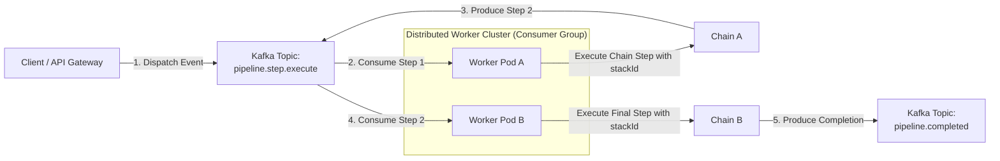

# Top 10 Event-Driven Use Cases for Rivulet & Apache Kafka

A comprehensive guide and reference document detailing the top 10 distributed, event-driven use cases powered by the combination of [**`Rivulet`**](https://github.com/rickzx98/Rivulet) and **Apache Kafka**, as described in [event-driven-via-kafka.md](./event-driven-via-kafka.md).

---

## Executive Overview

By combining `Rivulet`'s discrete step execution, end-to-end `stackId` execution tracing, structured retry strategies (`onFail`), declarative contracts (`spec`), and pluggable storage hooks with Apache Kafka's partitioned pub/sub messaging and consumer groups, teams can construct highly scalable, fault-tolerant, and observable distributed workflow systems.

---

## Summary Matrix

| # | Use Case | Recommended Pattern | Key `Rivulet` Capabilities | Key Kafka Capabilities |
| :-: | :--- | :--- | :--- | :--- |
| **1** | **E-Commerce Saga Orchestration** | Pattern A (Routing Slip) | `onFail` retries, compensations, context merge | Partition affinity via `orderId`, DLQ |
| **2** | **AI / LLM & RAG Pipelines** | Pattern B (Event Choreography) | Deterministic caching, TTL, step isolation | Granular autoscaling per step, Claim-Check |
| **3** | **Financial Transaction & Fraud** | Pattern A (Routing Slip) | `spec` contracts, unbroken `stackId` trace | Strict FIFO partition ordering, idempotency |
| **4** | **Media Transcoding & Assets** | Pattern B (Event Choreography) | `AbortSignal` cancellation, async lifecycle | Claim-check storage pointers, worker pools |
| **5** | **IoT Ingestion & Anomaly Detection** | Pattern A (Routing Slip) | Stateless context accumulation, high throughput | Device partition routing, consumer groups |
| **6** | **CDC & Data Lakehouse ETL** | Pattern A (Routing Slip) | Schema `transformer` & `translator`, deduplication | High-throughput streaming log, replayability |
| **7** | **KYC & Customer Onboarding** | Pattern A (Routing Slip) | Pluggable storage plugins, secure context | Polyglot worker steps, distributed state |
| **8** | **Healthcare FHIR Clinical Events** | Pattern A / B Hybrid | Standard Schema validation, HIPAA audit trail | W3C OpenTelemetry header propagation |
| **9** | **Omnichannel Notification Engine** | Pattern A (Routing Slip) | Dynamic chain sequences, localized fallback | Topic-per-channel routing, backpressure |
| **10** | **SecOps & Auto-Remediation** | Pattern A (Routing Slip) | Step envelope metadata, error capturing | Real-time webhook ingestion, event replay |

---

## Detailed Use Cases

### 1. E-Commerce Distributed Checkout & Saga Orchestration

* **Pipeline Flow**:
  `validateCart` $\rightarrow$ `reserveInventory` $\rightarrow$ `chargePayment` $\rightarrow$ `createShipment` $\rightarrow$ `sendConfirmationEmail`
* **Architectural Blueprint**:
  - **Pattern A (Routing Slip)** coordinates the saga across separate microservices (Cart, Inventory, Payments, Logistics, Notifications).
  - Kafka routes messages with `key = orderId` to ensure all stages of an order stay within the same partition, guaranteeing in-order execution.
* **Why Rivulet + Kafka**:
  - **Local vs. Cluster Retries**: Transient payment gateway timeouts are retried locally using `Rivulet`'s `onFail` with exponential backoff and jitter.
  - **DLQ & Compensating Actions**: If payment fails terminally, Kafka's Dead Letter Queue (`pipeline.dlq`) catches the failure event and triggers compensating rollbacks (e.g., `releaseInventory`).
  - **Context Accumulation**: Each step appends its output (`chargeId`, `trackingNumber`) into the context payload without side-effects on earlier inputs.

---

### 2. Multi-Stage AI / LLM & RAG Ingestion Pipeline

* **Pipeline Flow**:
  `extractDocumentText` $\rightarrow$ `chunkContent` $\rightarrow$ `generateEmbeddings` $\rightarrow$ `upsertVectorStore` $\rightarrow$ `indexSearchMetadata`
* **Architectural Blueprint**:
  - **Pattern B (Choreography)** decouples CPU-bound text extraction from rate-limited or GPU-dependent embedding generation.
  - Workers for `generateEmbeddings` auto-scale independently based on Kafka topic lag using Kubernetes HPA or KEDA.
* **Why Rivulet + Kafka**:
  - **Deterministic Caching**: Repetitive queries or re-indexed document chunks leverage `Rivulet`'s built-in TTL caching to avoid duplicate token costs with LLM providers.
  - **Claim-Check Pattern**: Large extracted documents and embedding vectors are stored in Redis or S3; only the reference pointer and `stackId` travel over Kafka.
  - **Step Isolation**: If an upstream model is deprecated or swapped, only the specific `generateEmbeddings` chain implementation changes.

---

### 3. Financial Transaction Processing & Fraud Detection

* **Pipeline Flow**:
  `ingestTransaction` $\rightarrow$ `validateKycLimits` $\rightarrow$ `runMlFraudModel` $\rightarrow$ `executeLedgerTransfer` $\rightarrow$ `emitAuditLog`
* **Architectural Blueprint**:
  - Messages are partitioned by `accountId` to enforce strict sequential account balance updates.
  - Every step is idempotent, using a deduplication key composed of `${stackId}-${transactionId}`.
* **Why Rivulet + Kafka**:
  - **Strict `stackId` Continuity**: Regulatory frameworks require an immutable audit trail showing exact step inputs and outputs. Preserving `stackId` across Kafka workers links all distributed steps back to a single ledger transaction.
  - **Declarative Contracts (`spec`)**: Strictly validates currency precision, account IDs, and balance parameters prior to executing irreversible ledger transfers.

---

### 4. Asynchronous Media Transcoding & Asset Processing

* **Pipeline Flow**:
  `receiveMediaUpload` $\rightarrow$ `extractMetadata` $\rightarrow$ `transcodeResolutions` $\rightarrow$ `generateThumbnails` $\rightarrow$ `syncCdn`
* **Architectural Blueprint**:
  - Dedicated consumer worker groups run heavy ffmpeg/GPU encoding tasks asynchronously.
  - Web applications return an immediate `202 Accepted` response with the `stackId` so clients can poll for status.
* **Why Rivulet + Kafka**:
  - **Distributed Cancellation**: If a user cancels an upload, an abort event published with `stackId` signals downstream workers to cancel ffmpeg processes via `AbortSignal`.
  - **Claim-Check Pattern**: Large raw video files remain in S3 buckets; steps pass presigned URLs and object metadata through the event envelope.

---

### 5. High-Throughput IoT Telemetry & Anomaly Detection

* **Pipeline Flow**:
  `ingestSensorBatch` $\rightarrow$ `normalizeUnits` $\rightarrow$ `evaluateThresholds` $\rightarrow$ `triggerAlert` $\rightarrow$ `archiveColdStorage`
* **Architectural Blueprint**:
  - Ingestion gateway publishes sensor streams partitioned by `deviceId` or `fleetId`.
  - Distributed step workers process millions of events per minute with zero idle compute resources.
* **Why Rivulet + Kafka**:
  - **Stateless Pipeline Workers**: `DistributedStepExecutor` executes each chain step statelessly, scaling out horizontally to match load spikes.
  - **Data Normalization (`spec.transformer`)**: Converts diverse hardware unit formats (e.g., Celsius vs. Fahrenheit, PSI vs. Bar) into standardized domain schemas cleanly at step boundaries.

---

### 6. CDC (Change Data Capture) & Data Lakehouse ETL

* **Pipeline Flow**:
  `captureDbEvent` $\rightarrow$ `transformSchema` $\rightarrow$ `enrichFromCustomerService` $\rightarrow$ `deduplicate` $\rightarrow$ `sinkToWarehouse`
* **Architectural Blueprint**:
  - Debezium streams database write-ahead logs (PostgreSQL/MySQL) into Kafka topics.
  - `Rivulet` workers consume row diffs, enrich missing dimensions, and prepare columnar micro-batches.
* **Why Rivulet + Kafka**:
  - **Schema Translators (`translator`)**: Seamlessly maps legacy relational database table definitions into unified Parquet/Iceberg schema formats.
  - **Deterministic Deduplication**: Cache keys prevent identical change events from polluting downstream analytical warehouses.

---

### 7. Customer Onboarding & Identity Verification (KYC/AML)

* **Pipeline Flow**:
  `submitApplication` $\rightarrow$ `ocrDocument` $\rightarrow$ `verifyFacialBiometrics` $\rightarrow$ `screenSanctionsWatchlist` $\rightarrow$ `activateAccount`
* **Architectural Blueprint**:
  - Polyglot or specialized services collaborate over the same Kafka step envelope.
  - Long-running identity verification checks (which may take seconds or minutes) execute asynchronously without blocking API threads.
* **Why Rivulet + Kafka**:
  - **External Storage Plugins (`setPutChainContextPlugin`)**: Sensitive PII is encrypted and stored in secure persistent datastores (MongoDB/Redis) keyed by `stackId`, keeping Kafka event payloads compliant and lightweight.
  - **Resilient Third-Party Integrations**: Sanctions and biometric external APIs handle throttling gracefully through configured retry policies.

---

### 8. Healthcare HL7 / FHIR Clinical Event Integration

* **Pipeline Flow**:
  `receiveHl7Feed` $\rightarrow$ `validateFhirCompliance` $\rightarrow$ `anonymizePii` $\rightarrow$ `updateElectronicHealthRecord` $\rightarrow$ `dispatchProviderAlert`
* **Architectural Blueprint**:
  - Hospital clinical feeds stream HL7/v2 and FHIR messages into protected Kafka clusters.
  - Distributed workers parse, sanitize, and synchronize patient state across hospital departments.
* **Why Rivulet + Kafka**:
  - **HIPAA-Compliant Traceability**: Distributed `stackId` and W3C OpenTelemetry headers (`traceparent`) ensure every medical record modification is auditable across multi-service boundaries.
  - **Standard Schema Contracts**: Verifies medical JSON structures against FHIR specification contracts, rejecting corrupted records immediately to the DLQ.

---

### 9. Multi-Channel Notification & Marketing Campaign Dispatch

* **Pipeline Flow**:
  `triggerCampaign` $\rightarrow$ `resolveUserPreferences` $\rightarrow$ `renderTemplate` $\rightarrow$ `routeToChannel` $\rightarrow$ `trackEngagement`
* **Architectural Blueprint**:
  - A dynamic routing slip allows the dispatcher to customize `remainingChains` per recipient (e.g. `[sendPush, sendEmail]` or `[sendSms]`).
  - Worker pools for SMS, Push, and Email scale independently according to external gateway rate limits.
* **Why Rivulet + Kafka**:
  - **Dynamic Chain Execution**: Senders specify custom sequences in `remainingChains` without changing worker consumer code.
  - **Localized Gateway Retries**: Transient HTTP 429 rate-limiting from third-party notification APIs (Twilio, Sendgrid) are handled with exponential backoff before failing over to fallback channels.

---

### 10. Automated SecOps & Infrastructure Incident Remediation

* **Pipeline Flow**:
  `receiveMonitoringAlert` $\rightarrow$ `correlateLogs` $\rightarrow$ `executeRemediation` $\rightarrow$ `verifyHealth` $\rightarrow$ `postSlackSummary`
* **Architectural Blueprint**:
  - Monitoring hooks (Datadog, Prometheus Alertmanager, CloudWatch) stream incident events to Kafka.
  - Remediation workers execute progressive containment steps (e.g., cordoning Kubernetes nodes, rotating compromised tokens, terminating rogue pods).
* **Why Rivulet + Kafka**:
  - **Forensic Envelope**: Complete failure context (`failedAt`, `error`, `retryCount`, `stackId`) is automatically packaged into DLQ messages when remediation fails, alerting engineers with full diagnostic context.
  - **Safe Execution Chains**: Step lifecycles (`onBefore`, `onAfter`) enforce prerequisite checks (such as verifying maintenance window locks) before executing invasive remediation actions.
